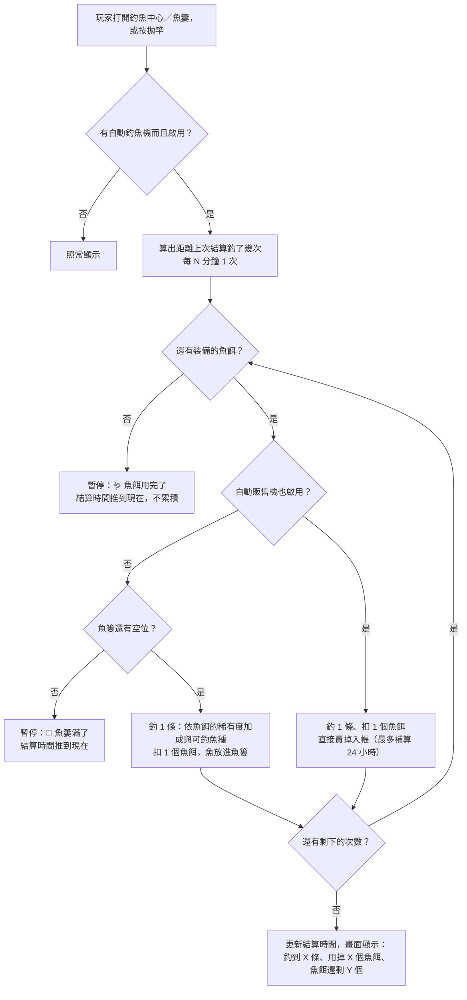
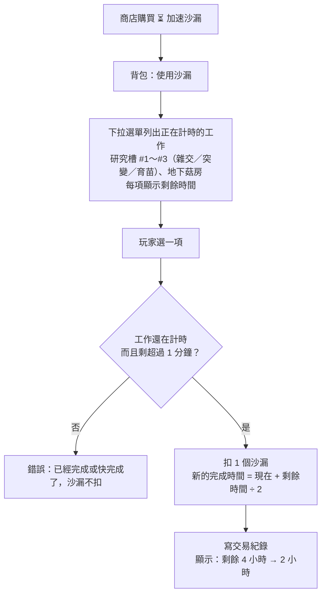
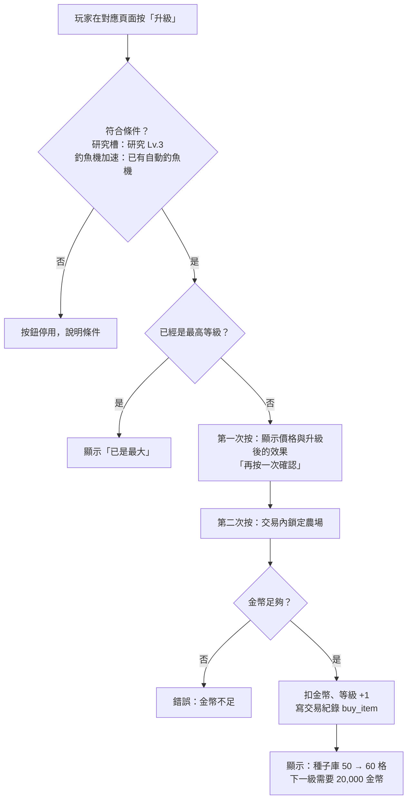
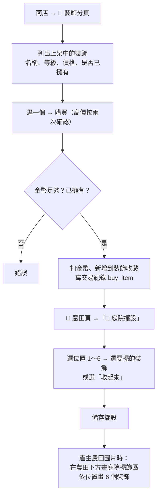

# 付費道具：設計與流程圖（v2，2026-11-15 已實作；加速沙漏改為 500 金，裝飾的價格固定在程式裡，其餘數值都在管理網站調整）

目的：回收金幣，但**只回收有錢、愛自動化的玩家**，不加重新手負擔。依 2026-11-15 正式環境 7 天的數據：

- 56 座農場、33 座活躍，29 座還在 Lv.1。
- 全服金幣約 24.5 萬，中位數 587，最多 5.1 萬。
- 7 天收入約 142 萬、支出約 127 萬（約 89%），沒有通膨。

所以下面四項都是「選用」的，不碰新手一定會付的費用（種子、餵食、擴建）。

| # | 項目 | 類型 | 回收對象 | 需要 Migration | 需要美術 |
|---|---|---|---|---|---|
| 1 | 自動釣魚機消耗魚餌 | 規則調整 | 有自動釣魚機的玩家 | 否 | 否 |
| 2 | ⏳ 加速沙漏（500 金） | 消耗品 | 想趕進度的玩家 | 否 | 否 |
| 3 | 逐級擴充（種子庫、研究槽、釣魚機加速） | 永久升級 | 中高端玩家 | 是（0042） | 否 |
| 4 | 🎨 農場裝飾 | 外觀 | 頂端玩家 | 是（0042） | **是**（見最後一節） |

所有數值都放在管理網站，做法和這次的「自動釣魚與魚簍」一樣。

---

## 1. 自動釣魚機消耗魚餌

規則：
- 每釣 1 條魚就消耗 1 個「目前裝備的魚餌」；沒有裝備魚餌、或魚餌用完時暫停。暫停的時間不累積。
- 既然用了魚餌，就套用魚餌的效果：稀有度加成，以及只有特定魚餌才釣得到的魚。原本只能釣不需要魚餌的魚，改成跟手動釣魚一樣。
- 和手動釣魚共用同一批魚餌。
- 管理網站新增設定：「自動釣魚消耗魚餌」開關（預設開）、每條消耗幾個（預設 1）。



畫面調整：
- 釣魚中心的機器狀態加上「🪱 魚餌還能釣 Y 次」。
- 魚餌少於 10 個時提醒補充。

---

## 2. ⏳ 加速沙漏（消耗品）

規則：
- 在道具商店購買（預設 500 金幣，管理網站「加速沙漏」可調）。
- 使用時選一個「正在計時的工作」，**剩餘時間減半**。
- 可以用在種子實驗室的研究槽（雜交、突變研究、育苗）和地下菇房。
- 同一個工作可以連續用，但剩餘時間少於 1 分鐘時不能用，避免浪費。
- 不能用在農田作物上，作物已經有化肥和蚯蚓。



入口：
- 背包的道具選單。
- 實驗室和菇房頁面的研究槽旁邊加「⏳ 使用沙漏」按鈕，有沙漏時才顯示。

---

## 3. 逐級擴充（永久升級）

三種擴充，都是「一級一級升、價格逐級變貴」，做法和魚簍升級、溫室一樣。

| 擴充 | 位置 | 每級效果 | 預設價格（管理網站可調） |
|---|---|---|---|
| 🌰 種子庫擴充 | 實驗室 →「🌰 種子庫」 | 容量 +10 | 10,000 → 20,000 → 40,000 → 80,000（最多 +40） |
| 🔬 研究槽擴充 | 實驗室主頁 | 研究槽 +1（研究 Lv.3 的 3 個 → 4 個） | 100,000（1 級） |
| ⚡ 自動釣魚機加速 | 釣魚中心（有機器時） | 間隔 5 → 4 → 3 分鐘 | 50,000 → 120,000 |

研究槽擴充要研究等級 Lv.3 才能買。自動釣魚機加速要先有自動釣魚機；加速後魚餌也會用得更快，這也是回收的一部分。



資料（Migration 0042）：
- `seed_labs.library_level`、`seed_labs.extra_slots`：整數，預設 0。
- 自動釣魚機加速等級存在 `farm_tools.settings.speed_level`，不用改資料表。

規則調整：
- 種子庫上限 = 設定的上限 + 10 × `library_level`。
- 研究槽數 = 研究等級 + `extra_slots`。
- 釣魚間隔 = 設定的各級間隔（`speed_level` 0 用基本間隔）。

---

## 4. 🎨 農場裝飾（外觀，不影響數值）

規則：
- 農田圖片左右兩側是**庭院**，最多擺 6 個裝飾（左上、左中、左下、右上、右中、右下）。
- 商店新分頁「🎨 裝飾」，買一次永久擁有；可以隨時換位置、收起來。
- 裝飾只改外觀，沒有任何加成。
- 分四個等級，價格固定在程式裡（`game/decor`，使用者指定裝飾不需要在管理網站調整）：

| 等級 | 例子 | 價格 |
|---|---|---|
| 普通 | 木桶、木箱、花圃、灌木 | 5,000 |
| 精緻 | 櫻花樹、路燈、稻草人、風車 | 20,000 |
| 稀有 | 噴水池、金色貓咪雕像、小涼亭、許願井 | 100,000 |
| 節慶 | 南瓜燈、雪人、聖誕樹 | 50,000 |

- 節慶裝飾目前整年都能買（之後要限定期間再加）。
- 成就可以加「庭院設計師」（擺滿 6 個），稱號另外做。



資料（Migration 0042）：
- 新表 `farm_decorations`：`farm_id`、`decor_code`、`acquired_at`、`slot`（NULL 表示收起來，1～6 表示擺放位置）。
- 唯一限制：同一座農場同一個位置只能擺一個。
- 裝飾目錄在 `game/decor`，圖片檔名用代碼對應（`bot/farmimage/farm/decor/<代碼>.png`）。

圖片版面（16 格農田 512×502 → 704×602，接近正方形；2026-11-15 由下方一條改成左右兩側）：

```
┌──────────────────────────── 704 ─────────────────────────────┐
│  上方草地（100，有寵物時畫寵物）                                  │
├────────┬──────────────────────────────────────────┬────────┤
│ 左上    │                                          │ 右上    │
│ 🌸花叢  │         原本的農田（512×502，不變）         │ 🌸花叢  │
│ 左中    │                                          │ 右中    │
│ 🌸花叢  │                                          │ 🌸花叢  │
│ 左下    │                                          │ 右下    │
└────────┴──────────────────────────────────────────┴────────┘
   96                                                    96
```

沒有擺任何裝飾的玩家，圖片維持原本的樣子。

---

## 需要的圖片素材

**只有第 4 項需要美術**，第 1～3 項在 Discord 用 emoji，不用畫。

一張圖可以放多個素材，我再裁切。共同規格：
- **透明背景 PNG**。
- 像素風，跟現在的作物、農田圖同一個風格（俯視角、有黑色描邊）。
- 每個素材放在固定大小的格子裡、置中，格子之間**不要有格線或底色**，排成整齊的網格方便裁切。

### A. 庭院草地條（1 張）

| 素材 | 尺寸 | 說明 |
|---|---|---|
| 草地條 | 512×76 | 接在農田圖下方。上緣要能和現在農田圖底部的木柵欄、草地自然接上，可以左右重複的草地紋理，兩端收邊。 |

### B. 裝飾（每個 64×64，建議一張 512×192 的圖，8 欄 × 3 列共 24 格）

現有 11 個可以直接用：木桶、灌木、莓果叢、木箱、花圃、路燈、松樹、花盆、櫻花樹、路牌、大樹（在 `farm/decor/`）。

需要新畫的，建議至少 13 個，可以放進同一張 24 格的圖：

| 等級 | 裝飾 | 代碼（暫定） |
|---|---|---|
| 精緻 | 稻草人 | `scarecrow` |
| 精緻 | 小風車 | `windmill` |
| 精緻 | 鞦韆 | `swing` |
| 精緻 | 狗屋 | `doghouse` |
| 精緻 | 鳥屋 | `birdhouse` |
| 精緻 | 南瓜堆 | `pumpkins` |
| 稀有 | 噴水池 | `fountain` |
| 稀有 | 金色雕像（可以是金色的農夫或雞） | `gold_statue` |
| 稀有 | 小涼亭 | `gazebo` |
| 稀有 | 許願井 | `wishing_well` |
| 節慶 | 南瓜燈（萬聖節） | `jack_o_lantern` |
| 節慶 | 雪人（冬季） | `snowman` |
| 節慶 | 聖誕樹（聖誕節） | `xmas_tree` |

規格補充：
- 物件底部貼齊格子下緣（會站在草地上），上方可以留白。
- 噴水池、涼亭這類大物件可以畫滿 64×64；小物件（鳥屋、南瓜燈）約佔 40～48 像素高。

### C.（選用）商店分頁的展示圖

如果想讓「🎨 裝飾」分頁也有圖片（像現在的商店場景圖），需要 1 張 640×360 的店面場景，放在 `farm/scenes/`。沒有的話就只用文字和 emoji 顯示。

---

## 建議的實作順序

1. **第 1 項**：自動釣魚機還沒部署，現在改最順，和自動釣魚機一起上線。
2. **第 2 項＋第 3 項**：一起做，Migration 0042 只放第 3 項的兩個欄位。
3. **第 4 項**：等素材到了再做。Migration 也可以先在 0042 一起建好，避免之後再多一個版本。
