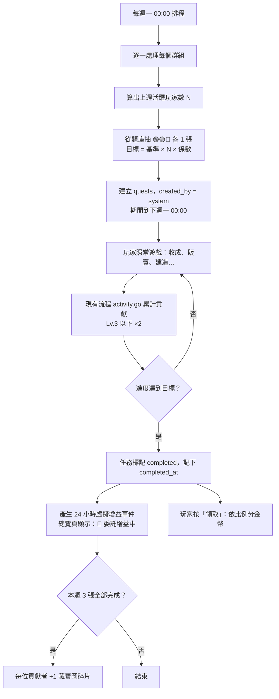
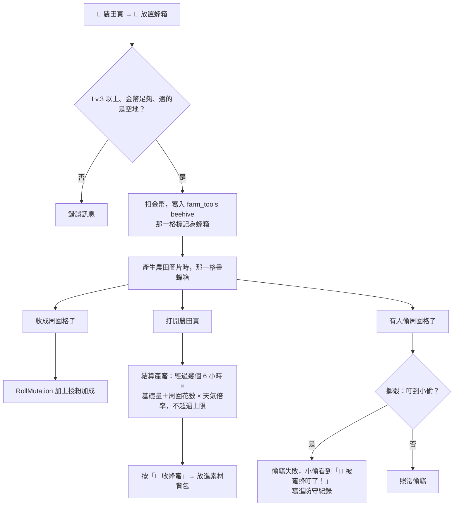
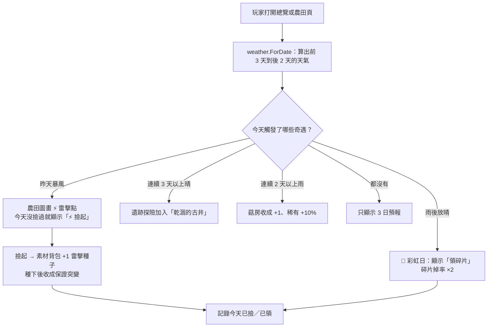
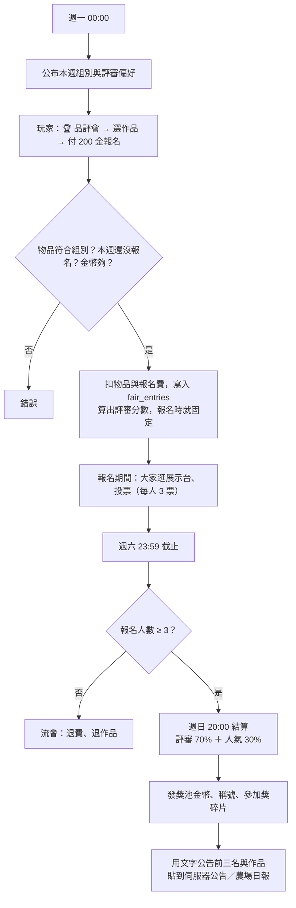
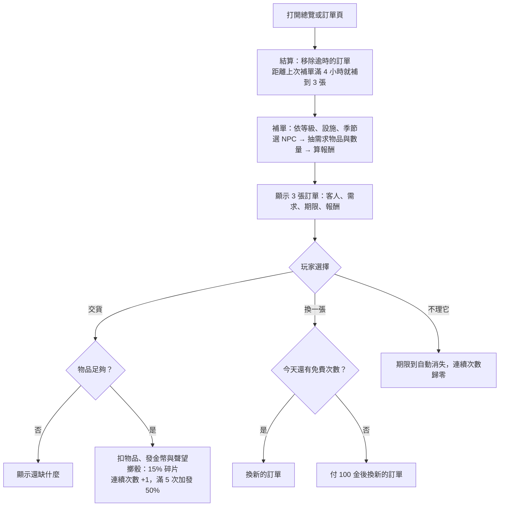
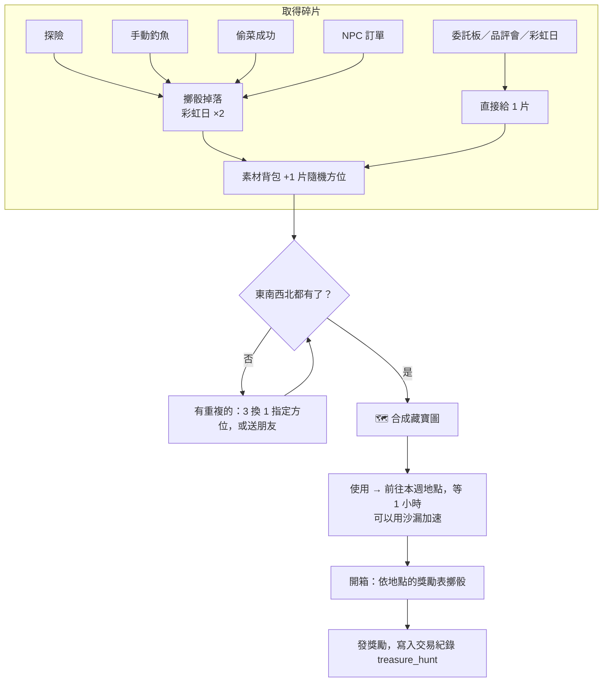

# 新玩法六項：設計與流程圖（v2 草案，2026-11-20，尚未實作；素材改成兩張合圖）

六項新玩法：**委託板、蜂箱、天氣奇遇、品評會、NPC 訂單、藏寶圖**。目標是**把現有系統串在一起**，不再另開一條和其他玩法無關的線。

設計時參考的現況（2026-11-15 正式環境數據）：

- 56 座農場，其中 33 座活躍、29 座還在 Lv.1。新功能不能讓新手更辛苦，最好能拉他們一把。
- 7 天內金幣支出約是收入的 89%，沒有通膨。新的獎勵要有對應的金幣回收。
- 天氣由日期決定，全伺服器相同（`weather.ForDate`）。所以**明天、後天的天氣現在就算得出來**，可以做預報和連續天數判斷。

| # | 項目 | 一句話說明 | 串起哪些系統 | Migration | 美術 |
|---|---|---|---|---|---|
| 2 | 📜 伺服器委託板 | 每週自動出伺服器共同目標，達成後全伺服器 24 小時增益 | 既有群組任務、事件 | 只有「交付」類型需要 | 委託板 1 張 |
| 3 | 🐝 蜂箱 | 佔 1 格農田，周圍 8 格的突變率提高，產蜂蜜，還會叮小偷 | 農田、突變、偷菜、天氣、加工 | 否 | 6 張 |
| 4 | 🌦️ 天氣奇遇 | 特定的天氣組合觸發限定事件，加上 3 日天氣預報 | 天氣、探險、菇房、藏寶圖 | 否（交易類型除外） | 3 張 |
| 5 | 🏆 品評會 | 每週拿一件最得意的作品參賽，評審評分、玩家投票 | 品質、突變、基因、稱號 | 是（2 張表） | 不用（emoji） |
| 8 | 🧑‍🌾 NPC 限時訂單 | NPC 客人來下單，限時交貨領高額報酬 | 加工、聲望、待辦區、藏寶圖 | 否（交易類型除外） | 6 張頭像 |
| 9 | 🗺️ 藏寶圖碎片 | 各種玩法都會掉碎片，集滿 4 片出發尋寶 | 探險、釣魚、偷菜、訂單、天氣 | 否（交易類型除外） | 4 張地點場景（物品用 emoji） |

> **⚠️ 和原本提議不同的地方**
> 1. **#2 委託板**：程式裡已經有「群組任務」（`quests` 表，有貢獻紀錄，獎勵可以依比例分配），只是要管理員手動建立。所以 #2 改成**沿用群組任務，加上每週自動出題和完成後的增益**，不另外建表。
> 2. **新的交易類型**：送禮功能當初為了 `aid_gift`、`aid_water` 加了 Migration 0044。由此判斷 `transactions.event_type` 有 CHECK 限制（限制寫在 Python 專案的 Migration 裡，Go 專案看不到，實作前要再確認）。所以本文件把所有新的交易類型**集中放進一個 Migration 0048**。

---

## 2. 📜 伺服器委託板

> ✅ **2026-11-20 已實作（v1）**，不需要 Migration。委託出現在現有的「📜 任務競賽」頁。和下面原始設計不同的地方：
> - **出題時間**：由 Bot 與網站的背景結算（`RunBackgroundSettlement`，接在每週拍賣後面）每隔一段時間檢查一次，本週還沒出題的群組就出題。所以週一 00:00 之後的下一次結算就會出題；上線當週也會立刻補出。同一週不會重複出題。
> - **活躍人數**：最近 7 天有遊戲操作、而且主要群組是這個群組的農場數。只替有活躍玩家的群組出題，沒人玩的伺服器不會一直累積任務。
> - **任務類型**：只用不需要 Migration 的「收成」與「販賣」。「交付」類型（會扣物品）要放寬資料庫限制，這次沒有做。
> - **新手加倍**：Lv.3 以下的農場，委託的貢獻 ×2（只限委託板的任務，管理員建立的任務不受影響）。
> - **增益**：🟢 澆水後生長時間 -5%、🟡 作物售價 +5%、🔴 種下的作物突變率 +0.5%。只對主要群組是這個群組的玩家有效，總覽底部會顯示。
> - **三張全部完成**：之後每位玩家領委託獎勵時，每週一次多得 1 片藏寶圖碎片。
> - **⚠️ 查詢次數**：有加入群組的玩家，種植、澆水、收成、販售時多 1 次查詢（批次操作只多 1 次）。`querycount_test` 的上限從 153 調成 156，實測後可以收緊。
> - **還沒做的**：
>   - 管理網站的題庫和數值設定（目前寫在 `game/questboard`）。
>   - 交付類型的委託。

### 規則

- 每週一台灣時間 00:00，系統替每個伺服器（群組）自動建立 **3 張委託**，`created_by = 'system'`。委託從「題庫範本」裡挑，分成三種難度：
  - 🟢 **簡單**：新手也做得到，例如「收成小麥 500 個」。
  - 🟡 **普通**：例如「賣出 30 萬金的作物」。
  - 🔴 **困難**：例如「蓋 10 棟建築」或「交付 50 罐果醬」。
- **目標數量依伺服器活躍人數調整**：目標 = 範本基準 × 上週活躍玩家數 × 係數（係數可以在管理網站調整）。這樣小伺服器也有機會達成。
- 現有的任務類型（收成、販賣、建造、動物、防守）**不需要 Migration**。
- 「交付」類型會真的扣掉玩家的物品（例如交 50 罐果醬），必須放寬 `ck_quests_type_valid` 和 `ck_quests_filter_only_for_animal`，所以要 **Migration 0048**。第一版可以先不做交付類型。
- **新手加權**：農場 Lv.3 以下的玩家，貢獻記錄時 ×2。依比例分獎勵時新手拿得比較多，也比較有動力參加。預設開啟，管理網站可以關閉。
- **完成獎勵**：
  1. 用現有的獎勵流程（`ClaimQuest`）依比例發金幣。
  2. 全伺服器 24 小時增益，三張委託各自不同：🟢 生長時間 -5%、🟡 售價 +5%、🔴 突變率 +0.5%。
  - 增益的做法和天氣一樣，是一個**虛擬事件**：從「這個群組最近 24 小時內完成的委託」算出來，不寫資料庫，也不需要 Migration。
  - 一個玩家同時屬於多個群組時，只看他**目前所在的那個群組**。
- **三張全部完成**：每位貢獻者再拿到 1 片藏寶圖碎片（連動 #9）。
- 管理員手動建立的任務照舊，不受影響。



### 畫面

- 總覽頁的「🧭 更多功能」新增「📜 委託板」。內容是三張委託的進度條、我的貢獻、剩下幾天。
- 待辦區：有可以領的委託獎勵時，顯示「📜 有委託獎勵可以領」。依照之前的偏好，這類提示要**放在面板底部、靠近按鈕**。

### 管理網站「新功能設定 → 委託板」

開關、每週張數、題庫（類型、指標、物品、基準目標、獎池、增益種類與數值）、人數係數、新手加權開關與倍率、增益持續時數。

---

## 3. 🐝 蜂箱

> ✅ **2026-11-20 已實作（v1）**，入口在總覽的「🧭 更多功能 → 蜂箱」，蜂箱也會畫在農田圖上。和下面原始設計不同的地方：
> - **不需要 Migration**：蜂箱存在 `farm_tools`（`beehive`）的 JSON 裡。放置、升級、搬移的費用記成 `buy_item`；收蜂蜜記成 `craft_collect`（會登記圖鑑）。被蜜蜂叮跑時，`steal_records.blocked_by` 寫 `beehive`（狗狗的 `pet_dog` 也是這樣加的）。
> - **授粉加成在「種下」時套用**：作物的突變是播種時就決定的，所以是「周圍格子種下的作物」突變率提高，不是收成時才提高。
> - **⚠️ 新的物品代碼**：`honey`、`honey_cake`、`honey_milk`。和新果醬一樣，有玩家取得後就不能切回 Python 版 Bot。
> - **蜂箱那一格的保護**：
>   - 所有種植方式都擋住了：單格種、全部種滿、自動播種機、收成並重種、實驗室種子、雷擊種子。
>   - 那一格在畫面上是新的狀態「🐝 蜂箱」，不算空地。
> - **查詢次數**：農場 Lv.3 以上，每次讀農場狀態會多 1 次查詢；Lv.1、2 不受影響。批次種植只多查 1 次。
> - **還沒做的**：
>   - 每座農場最多 2 個蜂箱。
>   - NPC 訂單要蜂蜜。
>   - 管理網站的數值設定（目前寫在 `game/beehive`）。
>   - 叮小偷的資料庫測試（需要群組和兩位玩家，下次補）。

### 規則

- **農場 Lv.3** 開放。在「🌱 農田」頁按「🐝 放置蜂箱」，選一格空地放下。
- **蜂箱會佔用 1 格農田**，那一格不能種東西。這是刻意設計的取捨：犧牲 1 格，換周圍格子的加成。
- 價格：Lv.1 8,000 金。可以升到 Lv.3，升級費 20,000 金、50,000 金，回收中高端玩家的金幣。
- 每座農場最多 1 個蜂箱，之後可以考慮擴充到 2 個。
- 可以搬到別格，每次搬移 500 金。

| 效果 | Lv.1 | Lv.2 | Lv.3 |
|---|---|---|---|
| 🌸 授粉：周圍 8 格（3×3）的作物收成時，突變率加成 | +1% | +1.5% | +2% |
| 🍯 產蜜：每 6 小時產生的蜂蜜（周圍每有 1 格花類作物 +1） | 1 | 2 | 3 |
| 🐝 叮小偷：別人偷周圍格子時失敗的機率 | 15% | 20% | 25% |
| 蜂蜜存量上限 | 10 | 20 | 30 |

- 突變加成走現有 `genetics.RollMutation` 的 `eventBonusBP` 參數（1% = 100 BP），只套用在蜂箱周圍的格子。
- **花類作物**：月光花、星夜花、赤月花等。清單放在設定裡，之後新增的花可以直接加進去。
- **天氣連動**：☀️ 晴天產蜜 ×1.5，🌧️ 雨天 ×0.5，⛈️ 暴風當天蜂群躲起來不產蜜，但暴風不會吹走蜂箱。
- **蜂蜜的用途**：
  - 直接賣。
  - 烘焙坊做「🍯 蜂蜜蛋糕」。
  - 乳品工坊做「🥛 蜂蜜牛奶」。
  - 蜂蜜放在素材背包。
- 資料存在 `farm_tools`（`tool_code = beehive`）的 `settings` JSON：格子編號、等級、上次結算時間、蜂蜜存量。**不需要 Migration**。
- 種植服務要擋掉蜂箱那一格；一鍵種植、一鍵收成並重種都要跳過它。
- **相容性**：蜂蜜和兩種料理是新的物品代碼，和新果醬一樣，有玩家取得後就不能切回 Python 版 Bot。



### 管理網站「新功能設定 → 蜂箱」

開放等級、各級價格與效果、產蜜間隔、花類作物清單、天氣倍率、搬移費用。

---

## 4. 🌦️ 天氣奇遇

> ✅ **2026-11-20 已實作（v1）**。和下面原始設計不同的地方：
> - **雷擊種子不放背包**：玩家在「🌱 農田」種植選單選「⚡ 撿起雷擊種子」，就直接種進第一格空地。原因是：如果做成實驗室的特殊種子，收成時有 85% 機率取回同一顆種子（連突變一起），等於可以一直免費得到保證突變的種子。直接種下就不需要新的物品代碼，也不需要 Migration，交易紀錄沿用 `plant`。
> - **保證的突變**改成巨型、黃金、珍稀變種（一般農田本來就有的突變）。夜光是實驗室限定的突變，所以不用。
> - **彩虹日先不做**：它的獎勵是藏寶圖碎片，等 #9 上線再一起加。
> - **數值先寫在程式裡**（`internal/game/weather/luck.go`），管理網站的設定頁之後再加。
> - 程式位置：判定在 `game/weather/luck.go`；雷擊種子在 `services/weatherluck.go`；菇房在 `services/mushroom.go`；乾涸古井在 `game/exploration`（`AddDryWell`）；總覽的預報和待辦在 `bot/pages_main.go`；農田圖的雷擊點在 `farmimage.go`。

### 規則

天氣由日期決定，所以「昨天、今天、明天」的天氣都算得出來。下面四種組合會觸發限定事件：

| 奇遇 | 觸發條件 | 效果 |
|---|---|---|
| ⚡ **雷擊種子** | 昨天是 ⛈️ 暴風 | 今天每位玩家的農田上會出現 1 個發光的雷擊點。按「⚡ 撿起」得到 1 顆雷擊種子（每人每天 1 次）。雷擊種子會隨機變成 1 種當季作物，收成時**保證突變**（從黃金、巨大、夜光裡擲骰）。 |
| 🌈 **彩虹日** | 昨天是 🌧️ 雨天、今天是 ☀️ 晴天 | 總覽頁可以領 1 片藏寶圖碎片（每人 1 次）。今天各種玩法掉落碎片的機率 ×2（連動 #9）。 |
| 🏜️ **乾旱・乾涸古井** | 連續 3 天以上 ☀️ 晴天 | 「古代遺跡」探險新增限定事件「乾涸的古井」，有機率帶回水晶、古代硬幣、稀有種子。 |
| 🍄 **連綿細雨** | 連續 2 天以上 🌧️ 雨天 | 地下菇房每床每批收成 +1 朵，稀有菇機率 +10%。 |

- **🔮 3 日天氣預報**：總覽頁底部的天氣列改成「今天 ☀️／明天 🌧️／後天 ⛈️」，並提示「後天暴風，記得放防守設施」「明天是彩虹日」。玩家可以提早安排，例如先把加工排好、先收成。
- 奇遇只由日期決定，**不寫資料庫**。「今天撿過沒、領過沒」記在 `farm_tools`（`tool_code = weather_luck`）的 settings 裡。
- 雷擊種子是新的物品代碼，有 Python 相容性問題（同 #3）。突變沿用現有代碼，所以**不必動突變設定**。



### 管理網站「新功能設定 → 天氣奇遇」

每種奇遇的開關、連續天數門檻、雷擊種子可能的突變與權重、乾涸古井的獎勵表、菇房加成數值。

---

## 5. 🏆 品評會（每週作品比賽）

> ✅ **2026-11-20 已實作（v1），需要 Migration 0048**，入口在總覽的「🧭 更多功能 → 🎀 品評會」。
> Migration 檔：
> - `migrations/versions/0048_fair.py`：Alembic 檔，放在和 0001～0047 相同的資料夾。
> - `migration_0048/0048_測試資料庫手動套用.sql`：給沒有 Python 環境的測試資料庫直接執行。
>
> **⚠️ 部署順序**：Go 版啟動時要求資料庫版本**剛好等於** `0048`（`internal/db/check.go`）。所以要先在 Python 專案執行 `alembic upgrade head`，再更新 Go 版，否則 Bot 和網站都會啟動失敗。
>
> 和下面原始設計不同的地方：
> - **組別只有三組輪換**：🌾 作物、🍞 加工品、🧪 實驗室作物，沒有魚類組。魚放在魚簍，流會時要把魚還回去比較複雜，下一版再加。
> - **不能撤回或換作品**：每週只能報名一件，報名後就不能改。
> - **獎勵只有金幣和碎片**：前三名分獎金（報名費 ×150%，分 50%／30%／20%），其他參賽者各得 1 片藏寶圖碎片。稱號和獎盃裝飾沒有圖片，所以不發。
> - **結果不另外貼公告**：週日 20:00 後由背景結算處理，結果顯示在品評會頁的「上週結果」。
> - **同分的處理**：評審分數或票數相同的作品，拿到相同的名次分，不會因為報名先後吃虧。
> - **交易類型**：報名記成 `fair_entry`；名次獎金和流會退費都記成 `fair_reward`。
> - **還沒做的**：
>   - 魚類組。
>   - 撤回報名。
>   - 稱號。
>   - 管理網站的數值設定（目前寫在 `game/fair`）。

### 規則

- 以**伺服器（群組）**為單位，每週一場。週一 00:00 開始報名，週六 23:59 截止，週日 20:00 公布結果。
- **每週輪換組別**，讓不同玩法的玩家都有機會：
  1. 🌾 作物組
  2. 🐟 魚類組
  3. 🍞 加工品組
  4. 🧪 實驗室組（雜交作物、特殊種子作物）
- 每位玩家每週報名 **1 件**作品，報名費 200 金。報名費全部放進獎池，系統再補 50%。
  - 參賽作品**會被收走**，不退回。這是物品回收，讓頂端玩家拿出最好的東西。
  - 截止前可以撤回，換成別件作品，但報名費不退。
- **評審分數**＝基準售價 × 品質倍率 × 突變倍率 × 基因分數（只有特殊種子有）× **本週評審偏好**。
  - **本週評審偏好**由週次的雜湊決定，例如「評審今天偏愛紅色系 +20%」「偏愛巨大突變 +30%」。週一就公布，增加變化，也避免永遠是同一批人贏。
- **人氣獎**：報名期間，同伺服器的玩家每人有 3 票，可以投給別人的作品（不能投自己）。
- **最終分數**＝評審分數的排名分 × 70% ＋ 人氣票的排名分 × 30%。
- **獎勵**：

| 名次 | 獎勵 |
|---|---|
| 🥇 第 1 名 | 獎池 50%、本週限定稱號「金牌農夫」 |
| 🥈 第 2 名 | 獎池 30%、稱號「銀牌農夫」 |
| 🥉 第 3 名 | 獎池 20%、稱號「銅牌農夫」 |
| 其他參賽者 | 參加獎：1 片藏寶圖碎片 |
| 人氣最高 | 「人氣王」稱號 |

- 報名少於 3 人時，那一週流會，退還報名費和作品。
- **資料（Migration 0048）**：
  - 新表 `fair_entries`：週次、`group_id`、`player_id`、物品快照（代碼、品質、突變、基因）、評審分數、票數、名次。唯一限制（週次, group_id, player_id）。
  - 新表 `fair_votes`：週次、`group_id`、投票者、作品 id。唯一限制（投票者, 作品 id）；每人票數上限由程式檢查。
  - 交易類型：`fair_entry`（扣報名費和作品）、`fair_reward`（發獎）。
- 品評會不用圖片：作品、名次和獎牌都用文字和 emoji（🥇🥈🥉）顯示。



### 管理網站「新功能設定 → 品評會」

開關、報名費、系統補貼比例、組別輪換順序、評審偏好題庫、評審和人氣的權重、獎池分配、最少參賽人數。

---

## 8. 🧑‍🌾 NPC 限時訂單

> ✅ **2026-11-20 已實作（v1）**，入口在總覽的「🧭 更多功能 → NPC 訂單」。和下面原始設計不同的地方：
> - **不需要 Migration**：交貨記成既有的 `sell`（把東西賣給 NPC），換單費記成 `buy_item`。⚠️ 交貨的金額比市價高，所以會算進「販賣」類的群組任務和競賽。
> - **交貨收任何品質**，但先扣品質最低的；黃金、珍稀變種不收（避免把值錢的東西交出去）。
> - **老漁夫**改成要小麥、玉米、胡蘿蔔、番茄（「做魚餌用」）。魚放在魚簍，不在倉庫，第一版先不收魚。
> - **還沒做的**：
>   - 交貨不會加農會聲望。
>   - VIP 不限「每天第一張」，改成每張新訂單都有 5% 機率。
>   - 數值寫在 `game/npcorder`，還不能在管理網站調整。
> - 待辦區會顯示「NPC 訂單 N 張，最快幾點到期」。

### 規則

- 總覽頁的「📋 訂單」最多同時有 **3 張訂單**。每 4 小時補到 3 張。
- 每張訂單包含：
  - 客人（6 位 NPC，各有喜好，見下表）。
  - 需要 1～3 種物品。
  - 期限 2～6 小時。
  - 報酬：市價 × 1.3～1.8 的金幣，加上農會聲望。另有 15% 機率附 1 片藏寶圖碎片（連動 #9）。
- **只出玩家做得出來的東西**：依照農場等級、已蓋好的加工設施、本季能種的作物抽題。Lv.1 只會要小麥、胡蘿蔔這類基本作物，新手也接得了。
- 交貨時扣物品、發報酬。逾時的訂單自動消失，沒有懲罰。
- **不想要的訂單**可以換一張：每天免費換 1 次，之後每次 100 金（小額金幣回收）。
- **連續完成獎勵**：連續完成 5 張（中間沒有逾時）時，額外 +50% 報酬，連續次數歸零。
- **VIP 客人**：每天第一張訂單有 5% 機率是 VIP。VIP 要的是高階加工品或突變作物，報酬 ×3。
- 資料存在 `farm_tools`（`tool_code = npc_orders`）的 settings：訂單清單、補單時間、今天換單次數、連續次數。**不需要新表**。
- 交易類型 `npc_order` 放進 Migration 0048。
- 待辦區顯示「📋 有 2 張訂單可以交貨」「⏰ 麵包師的訂單剩 30 分鐘」。依照之前的偏好，放在**面板底部**。

| NPC | 喜好 | 個性台詞範例 |
|---|---|---|
| 👩‍🍳 麵包師 蜜拉 | 麵粉、麵包、蜂蜜 | 「今天的可頌缺麵粉，拜託了！」 |
| 🧓 老漁夫 阿海 | 魚、魚餌 | 「年輕人，幫我找條好魚。」 |
| 👧 小女孩 小葵 | 草莓、果醬、花 | 「我想送媽媽一束花！」 |
| 🧙 藥草師 莫爾 | 菇類、特殊種子作物 | 「這朵菇……正是我要的。」 |
| 🤠 牧場主 老傑 | 牛奶、蛋、羊毛、起司 | 「牧場忙不過來，幫個忙！」 |
| 🎩 美食評論家 VIP | 高階加工品、突變作物 | 「讓我看看你的真本事。」 |



### 管理網站「新功能設定 → NPC 訂單」

開關、同時訂單數、補單間隔、期限範圍、報酬倍率範圍、換單費用、連續獎勵、VIP 機率與倍率、各 NPC 的喜好清單。

---

## 9. 🗺️ 藏寶圖碎片

> ✅ **2026-11-20 已實作（v1）**，入口在總覽的「🧭 更多功能 → 藏寶圖」。和下面原始設計不同的地方：
> - **碎片不是背包物品**：碎片和尋寶進度存在 `farm_tools`（`treasure_map`）的 JSON 裡，所以不需要新的物品代碼，資料庫仍然可以切回 Python 版。
> - **不需要 Migration**：開箱記成既有的 `rumor_treasure`（傳聞寶藏，日報會報出挖到寶藏的人），換碎片記成 `exchange`。
> - **「合成藏寶圖」和「出發」合成一個按鈕**：東南西北各 1 片就能直接出發。
> - **彩虹日已經做好**：碎片掉率 ×2，每人可以領 1 片。
> - **還沒做的**：
>   - 送碎片給朋友。
>   - 用沙漏加速尋寶。
>   - 開到限定裝飾，以及「海盜王」「幸運兒」這類成就。
>   - 委託板、品評會掉碎片（那兩項還沒做）。
> - 寶藏地點每週一由日期決定，全伺服器相同；開箱獎勵是金幣，加上 2 次素材或稀有種子（表在 `game/treasure`）。

### 規則

- 碎片有 4 種：**北、東、南、西**，都放在素材背包。
- **掉落來源**（數值都可以在管理網站調整；🌈 彩虹日時全部 ×2）：

| 來源 | 機率 |
|---|---|
| 探險 | 每次 8% |
| 釣魚（手動） | 每條 1%；自動釣魚機不會掉，避免掛機刷碎片 |
| 偷菜成功 | 每次 2% |
| NPC 訂單 | 每張 15%（#8） |
| 委託板 | 3 張全部完成時 +1（#2） |
| 品評會 | 參加獎 +1（#5） |
| 彩虹日 | 每人領 1 片（#4） |

- **合成藏寶圖**：北、東、南、西各 1 片 → 1 張藏寶圖。
- **本週寶藏地點**：每週輪換，由週次的雜湊決定，全伺服器相同。
  1. 🏝️ 沉船灣
  2. 🌳 老橡樹下
  3. ⛏️ 廢棄礦道
  4. 🗿 遺跡祭壇
  - 不同地點的獎勵表不同。例如沉船灣多魚餌和稀有魚，礦道多水晶。
- **尋寶**：使用藏寶圖，等 1 小時後開箱。不佔用探險的時間，可以用沙漏加速（又是一個沙漏的用途）。
- **獎勵**（擲骰）：金幣、稀有種子、實驗室材料（水晶）、魚餌，還有很低的機率開到現有的稀有裝飾（從 `game/decor` 的稀有等級裡抽，已經有的就換成金幣）。碎片和藏寶圖不畫圖，用 🧩、🗺️ 顯示；開箱時顯示該地點的場景圖（見合圖 A）。
- **重複碎片**：
  - 3 片相同的碎片，可以加 300 金換成 1 片指定方位的碎片（金幣回收）。
  - 也可以送給同伺服器的玩家，走現有的送禮流程，每天上限沿用送禮的設定。這是社交互動。
- 資料：碎片和藏寶圖是素材背包裡的物品（新的物品代碼，有 Python 相容性問題）。尋寶狀態存在 `farm_tools`（`tool_code = treasure_hunt`）的 settings。交易類型 `treasure_hunt` 放進 Migration 0048。
- 成就（之後加）：「尋寶新手」（第 1 次開箱）、「四方旅人」（4 個地點都去過）、「幸運兒」（開到稀有裝飾）。



### 管理網站「新功能設定 → 藏寶圖」

各來源的掉落率、彩虹日倍率、尋寶時間、各地點的獎勵表、3 換 1 的費用、送碎片開關。

---

## Migration 0048（在 Python 專案，一次放進去）

| 內容 | 給哪一項 |
|---|---|
| `transactions.event_type` 新增 `npc_order`、`fair_entry`、`fair_reward`、`treasure_hunt`、`beehive`、`weather_luck` | #3 #4 #5 #8 #9 |
| 放寬 `ck_quests_type_valid`，新增 `deliver`；放寬 `ck_quests_filter_only_for_animal`，讓 `deliver` 也能指定物品 | #2（交付類型） |
| 新表 `fair_entries`、`fair_votes` | #5 |

> 實作前要先到 Python 專案確認 `transactions` 真的有 event_type 的 CHECK 限制。如果沒有，#3、#4、#8、#9 就完全不需要 Migration。
> 這些功能取得的新物品代碼（蜂蜜、蜂蜜料理、雷擊種子、碎片、藏寶圖）會讓資料庫**無法再切回 Python 版 Bot**，和新果醬一樣。

---

## 需要的圖片素材（v2，2026-11-20 改成兩張合圖）

> ✅ **2026-11-20 素材已到齊**：`4map.png`（合圖 A）、`fg.png`（合圖 B）已裁切成 20 個檔案，放在 `internal/bot/farmimage/farm/` 下面，檔名照下表。場景已壓成 256 色，和現有場景一樣。還沒登記到 `manifest.json`，實作各功能時再加。
> ⚠️ 4 張寶藏場景上方的木牌有**中文地名**，英文介面也會顯示中文。

**只畫兩張合圖**，我再裁切、縮放。品評會和藏寶圖的物品**不畫**，在 Discord 用 emoji 顯示（碎片 🧩、藏寶圖 🗺️、獎牌 🥇🥈🥉）。乾涸古井沿用現有的 `scenes/explore_ruins.png`。

### 共同規格

- 像素風（pixel art），深色外框、柔和明暗，和現有的 `farm/items/`、`farm/scenes/explore_*.png` 同一個風格。
- 每個素材放在自己的格子裡並且置中，**格子之間不要有格線、邊框或文字**。
- **背景**：合圖 B 的物件要去背。如果生成工具做不出透明背景，就用**純色洋紅 `#FF00FF`** 當底色（素材本身不要用到這個顏色），我再把它去掉。合圖 A 是完整場景，不用去背。
- 提示詞裡的「cozy pixel farming game」只是描述畫風，不要拿現有遊戲的角色或圖當參考。

---

### 合圖 A：寶藏地點場景（4 格，2×2）

- 畫布 **1:1**，建議 1400×1400。每格 700×700，和現有的探險場景一樣大（`explore_ruins.png` 是 697×699）。
- 排列：

```
┌──────────────┬──────────────┐
│ 左上          │ 右上          │
│ 🏝️ 沉船灣     │ 🌳 老橡樹下    │
├──────────────┼──────────────┤
│ 左下          │ 右下          │
│ ⛏️ 廢棄礦道   │ 🗿 遺跡祭壇    │
└──────────────┴──────────────┘
```

| 位置 | 裁切後檔名 | 地點 |
|---|---|---|
| 左上 | `scenes/treasure_shipwreck.png` | 🏝️ 沉船灣 |
| 右上 | `scenes/treasure_oak.png` | 🌳 老橡樹下 |
| 左下 | `scenes/treasure_mine.png` | ⛏️ 廢棄礦道 |
| 右下 | `scenes/treasure_altar.png` | 🗿 遺跡祭壇 |

**提示詞（整段直接貼）：**

```
A pixel art sprite sheet of 4 separate full-scene illustrations arranged in a 2x2 grid
on a square canvas, each panel exactly one quarter of the canvas, panels separated only
by a thin plain gap (no borders, no frames, no text, no labels, no numbers).
Style: 16-bit cozy pixel farming game, dark outlines, soft shading, slightly top-down
3/4 view, rich but gentle colors, consistent lighting and palette across all 4 panels,
each panel composed like an exploration destination background with an open area in
the lower middle.

Top-left panel - "Shipwreck Cove": a hidden sandy cove with a broken wooden pirate
ship lying on its side, turquoise shallow water, palm trees, scattered barrels, a
half-buried treasure chest in the sand, seagulls, bright daylight.

Top-right panel - "Under the Old Oak": a giant ancient oak tree in a misty green meadow,
thick roots forming a small hollow, a shovel stuck in freshly dug soil, mushrooms and
fireflies, soft morning fog, gentle golden light.

Bottom-left panel - "Abandoned Mine Tunnel": an old mine tunnel with wooden support
beams, a rusty minecart on tracks, glowing blue and purple crystals in the rock walls,
a hanging oil lantern, dark cozy cave atmosphere with warm lantern light.

Bottom-right panel - "Ruins Altar": an overgrown stone altar deep in ancient ruins, moss
and hanging vines, carved stone pillars, a softly glowing chest on the altar, beams of
light through a broken ceiling, mysterious but friendly mood.
```

---

### 合圖 B：委託板、蜂箱、天氣奇遇、NPC 頭像（8×6 格）

- 畫布 **4:3**，建議 1024×768。每格 128×128，共 8 欄 × 6 列。
- 物品類畫在 128 格裡，我縮成 64×64（請用**大顆像素**畫，縮小後才清楚）。
- 委託板佔 4×4 格（512×512），彩虹佔最下面兩列。

```
     欄0    欄1    欄2    欄3  │  欄4      欄5      欄6       欄7
列0 ┌────────────────────────┐│ 麵包師    老漁夫    小女孩     藥草師
列1 │                        ││ 牧場主    美食評論家 雷擊點     雷擊種子
列2 │      📜 委託板          ││ 蜂箱Lv1   蜂箱Lv2   蜂箱Lv3    蜂蜜
列3 │      （4×4 格）         ││ 蜂蜜蛋糕  蜂蜜牛奶  （空）     （空）
    └────────────────────────┘│
列4 ┌──────────────────────────────────────────────────────────┐
列5 │               🌈 彩虹（橫跨整個寬度，8×2 格）                 │
    └──────────────────────────────────────────────────────────┘
```

| 位置 | 裁切後檔名 | 最後尺寸 | 用在哪裡 |
|---|---|---|---|
| 欄0–3 × 列0–3 | `scenes/quest_board.png` | 512×512 | #2 委託板頁 |
| 欄4 列0 | `npc/baker.png` | 128×128 | #8 麵包師 蜜拉 |
| 欄5 列0 | `npc/fisher.png` | 128×128 | #8 老漁夫 阿海 |
| 欄6 列0 | `npc/girl.png` | 128×128 | #8 小女孩 小葵 |
| 欄7 列0 | `npc/herbalist.png` | 128×128 | #8 藥草師 莫爾 |
| 欄4 列1 | `npc/rancher.png` | 128×128 | #8 牧場主 老傑 |
| 欄5 列1 | `npc/critic.png` | 128×128 | #8 美食評論家（VIP） |
| 欄6 列1 | `field/lightning_spot.png` | 64×64 | #4 農田上的雷擊點 |
| 欄7 列1 | `items/lightning_seed.png` | 64×64 | #4 雷擊種子 |
| 欄4 列2 | `field/beehive_1.png` | 64×64 | #3 蜂箱 Lv.1（農田格子） |
| 欄5 列2 | `field/beehive_2.png` | 64×64 | #3 蜂箱 Lv.2 |
| 欄6 列2 | `field/beehive_3.png` | 64×64 | #3 蜂箱 Lv.3 |
| 欄7 列2 | `items/honey.png` | 64×64 | #3 蜂蜜 |
| 欄4 列3 | `goods/honey_cake.png` | 64×64 | #3 蜂蜜蛋糕 |
| 欄5 列3 | `goods/honey_milk.png` | 64×64 | #3 蜂蜜牛奶 |
| 列4–5 全寬 | `field/rainbow_overlay.png` | 512×120 | #4 彩虹日疊在農田圖上方 |

**提示詞（整段直接貼）：**

```
A pixel art game asset sprite sheet on a 4:3 canvas, laid out as an invisible grid of
8 columns x 6 rows of equal square cells. Plain solid magenta (#FF00FF) background
everywhere except inside the quest board scene. No grid lines, no borders, no text,
no labels, no numbers, no letters anywhere. Every object is centered in its own cell
and does not touch neighboring cells. Style: 16-bit cozy pixel farming game, chunky
readable pixels, dark outlines, soft shading, slightly top-down 3/4 view, consistent
warm palette. Field objects (beehives, lightning spot) sit with their base touching
the bottom of their cell.

LEFT BLOCK (columns 1-4, rows 1-4, one big square scene):
A wooden village notice board standing in a small town square, three blank paper
request notes pinned on it with a green pin, a yellow pin and a red pin, wooden crates
and a small flowerbed beside it, cobblestone ground, warm afternoon light. The papers
are blank (no writing).

RIGHT BLOCK, row 1, columns 5-8 - four character portraits, head and shoulders, facing
slightly toward the viewer, friendly expressions, each inside a soft round pastel
circle:
1. a cheerful young woman baker with a white chef hat, flour on her cheek, brown hair
   in a bun, apron;
2. an old fisherman with a gray beard, yellow rain hat, weathered kind smile, fishing
   rod over his shoulder;
3. a little girl with twin pigtails and a sunflower hair clip, holding a small bouquet,
   big bright eyes;
4. a mysterious herbalist in a green hooded cloak with round spectacles and a small
   mushroom pouch, gentle smile.

RIGHT BLOCK, row 2:
column 5: portrait of a sturdy middle-aged rancher with a cowboy hat, plaid shirt,
mustache, holding a milk pail (same round pastel circle style);
column 6: portrait of an elegant food critic with a top hat, monocle, neat mustache,
purple vest, one raised eyebrow, small golden sparkle (same style);
column 7: a small scorched spot on brown farm soil struck by lightning, faint blue
electric sparks, one glowing seed in the center;
column 8: a single seed crackling with tiny blue-yellow lightning arcs, glowing softly.

RIGHT BLOCK, row 3:
column 5: a small simple wooden beehive box on short legs with two tiny bees;
column 6: a two-tier white painted wooden beehive with a little roof, tiny flowers at
its base, three bees;
column 7: a fancy three-tier beehive with golden trim and a little roof, honey dripping
from the entrance, several bees with a faint golden sparkle;
column 8: a glass jar of golden honey with a cloth lid tied with string and a wooden
honey dipper.

RIGHT BLOCK, row 4:
column 5: a slice of fluffy honey sponge cake with honey glaze dripping down, on a small
plate;
column 6: a glass bottle of creamy milk with a honey-colored swirl;
columns 7-8: empty magenta.

BOTTOM BLOCK (rows 5-6, full width):
a soft semi-transparent pastel rainbow arc spanning the whole width, with small fluffy
white clouds at both ends, on the magenta background.
```

> 合圖 B 的格子比較多。如果生成工具排不整齊，可以拆成兩次：委託板加彩虹一張，其他 14 個小素材一張，提示詞照段落拆開就好。

### 素材總計

| 合圖 | 內容 | 數量 |
|---|---|---|
| A | 寶藏地點場景 | 4 |
| B | 委託板 1、NPC 頭像 6、天氣奇遇 3（雷擊點、雷擊種子、彩虹）、蜂箱與蜂蜜 6 | 16 |
| **合計** | | **20** |

---

## 建議的實作順序

1. **#4 天氣奇遇＋3 日預報**：不需要 Migration，天氣系統已經做好，風險最低。素材到之前，可以先用 emoji 和文字上線預報與菇房加成。
2. **#9 藏寶圖＋#8 NPC 訂單**：兩者互相掉碎片，一起做。等 Migration 0048 的交易類型確認之後再上線。
3. **#3 蜂箱**：要改種植、收成、偷菜、農田圖片，影響範圍最大，測試要做足（一鍵操作、擴充到 17～32 格的情況）。
4. **#2 委託板**：先做「自動出題＋增益」，交付類型等 Migration 0048。
5. **#5 品評會**：需要新表和頒獎圖合成，放最後；正式環境的伺服器數多一點時效果也比較好。
