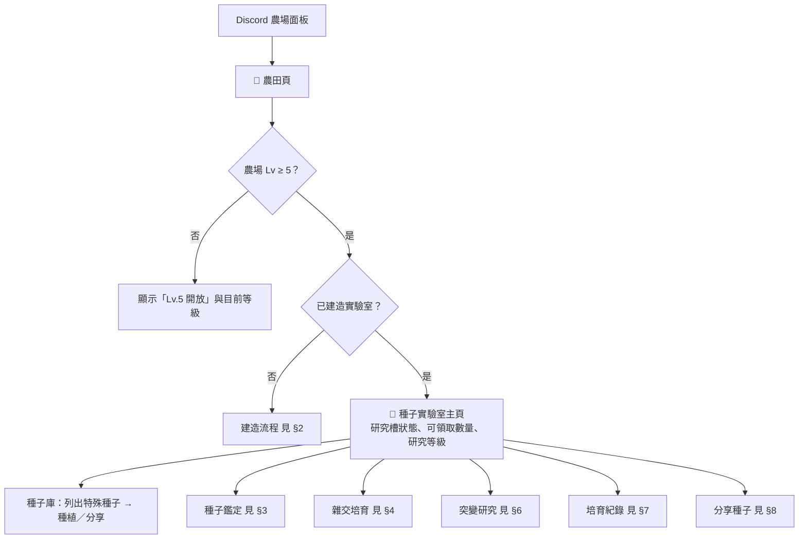
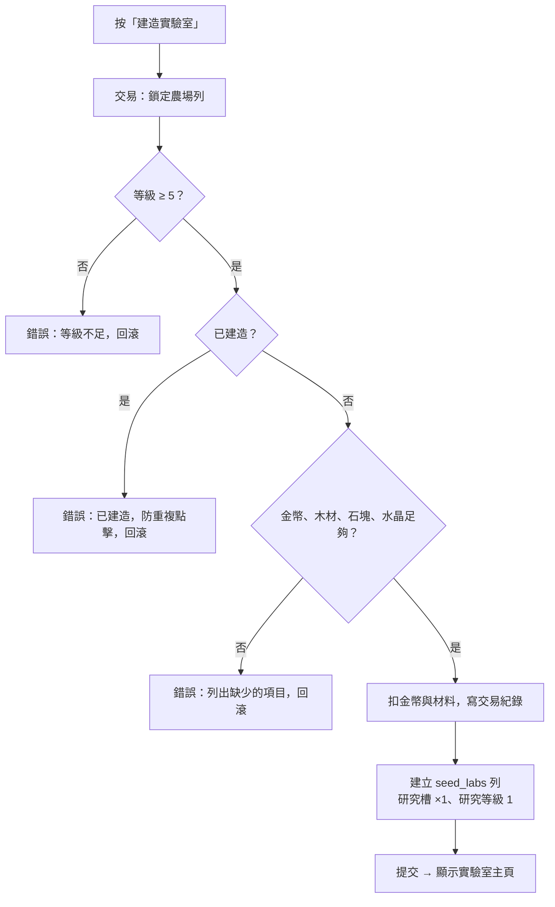
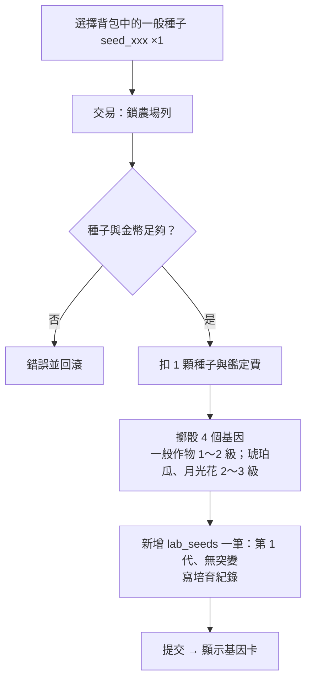
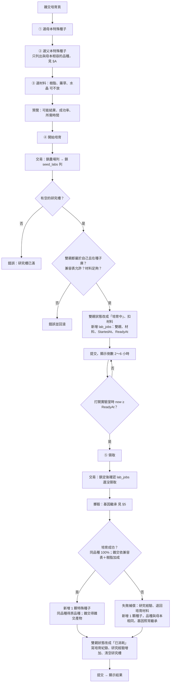
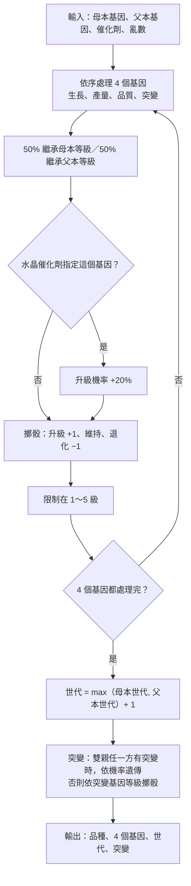
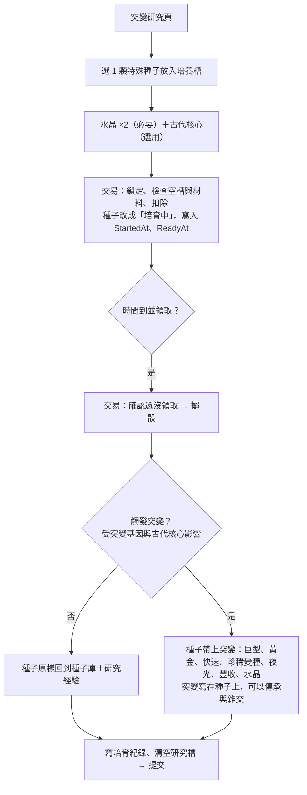
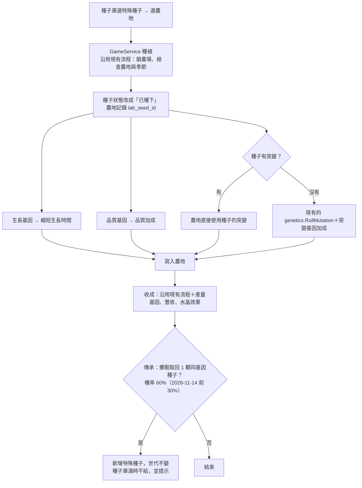
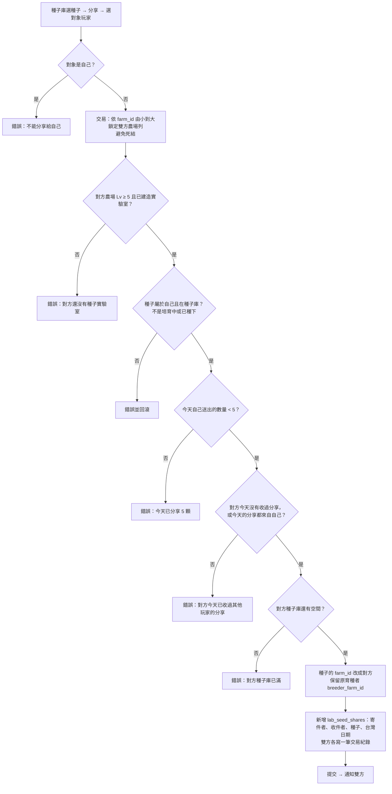

# 種子實驗室：設計與流程圖（v5，2026-11-13 已實作；建造只要金幣、培育 1–3 小時、沒有實驗室也能收分享、數值可在管理網站調整）

依現有架構規劃：
- 規則（純函式、可測試）放 `internal/game/seedlab`
- 服務放 `internal/services/seedlab.go`
- Discord 面板放 `internal/bot/pages_lab.go`
- 數值存在 `feature_settings`（key `seedlab`），管理網站可以調整，寫法和探險、地下菇房相同

寫法參考地下菇房：
- 用農場等級解鎖。
- 計時用 `StartedAt / ReadyAt`，玩家打開面板時才判斷是否完成，不用背景排程。
- 扣料、擲骰、發放都在同一筆交易內完成：先鎖農場列，再鎖實驗室資料，所以重複點擊不會重複扣料或重複領取。

## 已確定的決策（2026-11-13）

| # | 項目 | 決定 |
| --- | --- | --- |
| 1 | 資料庫 | **可以改**：在 Python 專案新增 Migration **0039**（`migrations/versions/0039_seed_lab.py`），Go 的 `db.AlembicHead` 改成 `"0039"` |
| 2 | 雜交雙親 | 只用現有作物（10 種：小麥、胡蘿蔔、番茄、草莓、玉米、南瓜、葡萄、西瓜、琥珀瓜、月光花） |
| 3 | 材料 | 只用現有素材（木材、石塊、水晶、樹脂、藥草、古代核心） |
| 4 | 突變 | 共用現有的 巨型 `giant`、黃金 `golden`、快速 `fast`、珍稀變種 `variant`；**新增** 夜光 `glow`、豐收 `bountiful`、水晶 `crystal` |
| 5 | 雜交產物 | 12 種，全部做成正式作物（寫入 `crop_types`），見 §A |
| 7 | 圖片 | 只做作物圖；實驗室頁不產生圖片（避免頻繁點擊時卡頓），新突變不畫標記 |
| 8 | 耐旱基因 | 不做，基因只有 4 種 |
| 9 | 備份 | 現階段只用 Go 版，Migration 前不另外備份 |
| 6 | 分享種子 | 每人每天最多送出 **5 顆**；每人每天只能收到 **1 位**玩家的分享，見 §8 |

---

## A. 雜交產物（12 種新作物）與兼容表

規則：
- **同品種**（例：草莓 × 草莓）一定相容，結果仍是同品種，用來改良基因。
- **不同品種**只有下表的組合可以雜交。母本、父本順序不影響結果。
- 雜交產物之間（例：紫莓 × 彩虹蘿蔔）第一版不能雜交，但雜交產物可以和同品種配對來改良基因。
- 數值是初稿，之後可以在管理網站「作物目錄」調整。
- 雜交產物的種子**商店不賣**，只能從實驗室取得或由其他玩家分享。
- 季節取雙親季節的聯集。

| # | 雙親 | 雜交產物（代碼） | 珍稀變種（代碼） | 生長 | 每次收成 | 單位售價 | 基礎成功率 |
| --- | --- | --- | --- | --- | --- | --- | --- |
| 1 | 小麥 × 玉米 | 🌾 黃金穀物 `golden_grain` | 太陽穀 `sun_grain` | 2 小時 | 3 | 22 | 70% |
| 2 | 胡蘿蔔 × 番茄 | 🥕 彩虹蘿蔔 `rainbow_carrot` | 極光蘿蔔 `aurora_carrot` | 4 小時 | 4 | 30 | 65% |
| 3 | 草莓 × 葡萄 | 🫐 紫莓 `purple_berry` | 午夜紫莓 `midnight_berry` | 12 小時 | 5 | 60 | 60% |
| 4 | 南瓜 × 西瓜 | 🍈 蜜糖瓜 `honey_melon` | 糖晶瓜 `sugar_crystal_melon` | 18 小時 | 4 | 120 | 55% |
| 5 | 琥珀瓜 × 南瓜 | 🏮 燈籠瓜 `lantern_gourd` | 金燈籠瓜 `golden_lantern_gourd` | 12 小時 | 4 | 150 | 50% |
| 6 | 月光花 × 草莓 | 🌌 星夜花 `starry_night_flower` | 銀河花 `galaxy_flower` | 24 小時 | 3 | 520 | 40% |
| 7 | 玉米 × 番茄 | 🌽 紅寶玉米 `ruby_corn` | 烈焰玉米 `blaze_corn` | 4 小時 | 4 | 32 | 65% |
| 8 | 小麥 × 草莓 | 🌸 櫻花麥 `sakura_wheat` | 夜櫻麥 `night_sakura_wheat` | 5 小時 | 4 | 38 | 60% |
| 9 | 胡蘿蔔 × 南瓜 | 🌇 夕陽瓜 `sunset_squash` | 晚霞瓜 `afterglow_squash` | 8 小時 | 4 | 75 | 60% |
| 10 | 葡萄 × 西瓜 | 💚 翡翠葡萄 `jade_grape` | 帝王翡翠葡萄 `imperial_jade_grape` | 20 小時 | 5 | 110 | 50% |
| 11 | 琥珀瓜 × 西瓜 | 🌅 曙光瓜 `dawn_melon` | 日冕瓜 `corona_melon` | 20 小時 | 3 | 190 | 45% |
| 12 | 月光花 × 番茄 | 🌺 赤月花 `crimson_moon_flower` | 血月花 `blood_moon_flower` | 18 小時 | 3 | 380 | 40% |

> 作物的珍稀變種（`variant_code`）是 `crop_types` 的必要欄位，所以每種雜交產物都要有一種變種。

## B. 需要的圖片素材

只需要農田上的植株圖：12 種 × 4 張必要（另有 2 張選用），規格與外觀建議見 [`種子實驗室_作物素材需求.md`](種子實驗室_作物素材需求.md)。

---

## C. 基因與突變的數值（初稿，管理網站可以調整）

### 基因（4 種，每種 1～5 級，1 級沒有加成）

| 基因 | 每升 1 級的效果 | 5 級時 |
| --- | --- | --- |
| 生長 | 生長時間 −6%（2026-11-14 前 −5%） | −24%（不低於 `MinGrowSeconds`） |
| 產量 | 收成數量 +15%，無條件進位（2026-11-14 前每 2 級 +1） | +60%（3 個收成 → +2） |
| 品質 | 品質加成 +500 bp（2026-11-14 前 +100 bp），接到 `genetics.EffectiveQualityBP` | +2,000 bp |
| 突變 | 突變加成 +150 bp（2026-11-14 前 +50 bp），接到 `genetics.RollMutation` | +600 bp |

### 新突變

新突變只能從實驗室的「突變研究」取得，一般種植不會出現。

| 突變 | 效果 |
| --- | --- |
| 夜光 `glow` | 售價 200%（依序疊加在品質倍率之後，和黃金的計算方式相同） |
| 豐收 `bountiful` | 收成數量 +50%（無條件捨去，至少 +1） |
| 水晶 `crystal` | 收成時額外得到 1～2 個水晶（素材） |

### 材料用途

| 用途 | 材料 | 數量／效果 |
| --- | --- | --- |
| 建造實驗室 | 木材、石塊、水晶、金幣 | 100、100、10、5,000 |
| 種子鑑定 | 金幣 | 種子價格的 1 倍、至少 10（2026-11-14 前 5 倍、至少 50） |
| 雜交（選用） | 樹脂（花粉） | 成功率 +15% |
| 雜交（選用） | 藥草（營養液） | 培育時間 −30% |
| 雜交（選用） | 水晶（催化劑） | 指定 1 個基因，升級機率 +20% |
| 突變研究（必要） | 水晶 | ×2 |
| 突變研究（選用） | 古代核心 | 突變機率加倍 |

---

## 1. 整體入口與面板

## 2. 解鎖與建造

## 3. 種子鑑定：一般種子 → 特殊種子

玩家的第一批特殊種子從這裡來。一般種子在背包裡只記數量，鑑定後才有自己的基因。

## 4. 雜交培育（主要玩法）

## 5. 基因繼承判定（純規則，`game/seedlab`）

> 例：父本產量 5 級、母本產量 2 級 → 有 50% 機率先繼承 5 級，再擲升級／退化。

## 6. 突變研究（不用雜交）

## 7. 種植、收成與傳承（接到現有種植流程）

## 8. 分享種子

**規則**
- 每人每天最多**送出 5 顆**。
- 每人每天只能**收到 1 位**玩家的分享。可以收同一位玩家的多顆，但總數仍受那位玩家每天 5 顆的限制。
- 「一天」以台灣時間（`clock.TaipeiTZ`）的日期計算。
- 直接贈送，不需要對方按接受。

> 兩項上限都在**鎖定雙方農場列之後**才查詢計數，並行送出時也不會超過上限。

---

## D. 資料庫變更（Migration 0039，在 Python 專案新增）

| 表／欄位 | 內容 |
| --- | --- |
| `seed_labs` | `farm_id`（PK）、研究等級、研究經驗、研究槽數、建造時間 |
| `lab_seeds` | `id`、`farm_id`（目前擁有者）、`breeder_farm_id`（原育種者）、`crop_code`、4 個基因等級、世代、突變、狀態（種子庫／培育中／已種下／已消耗）、來源紀錄、建立時間 |
| `lab_jobs` | `id`、`farm_id`、類型（雜交／突變）、母本、父本、材料 JSON、`started_at`、`ready_at`、`collected_at` |
| `lab_records` | 培育紀錄：雙親快照、結果品種、基因、世代、突變、是否成功、時間 |
| `lab_seed_shares` | `sender_farm_id`、`receiver_farm_id`、`lab_seed_id`、`share_date`（台灣日期）、建立時間；索引建在（寄件者, 日期）和（收件者, 日期） |
| `farm_plots` 新增欄位 | `lab_seed_id`（收成或清除時改成 NULL，種子標記為已消耗） |
| `crop_types` | 新增 12 種雜交產物，沿用既有欄位 `shop_buyable = false`（商店不賣，種子製造機也不能做） |

**注意事項**
- 現有的 `genetics` 設定把突變機率存成 JSON。新增的 3 種突變在舊設定裡沒有對應欄位，讀取時要當成 0，`ValidateSettings` 也要允許。
- 相容性：和新果醬、地下菇房一樣，Python 版不認得這些資料。上 0039 之後就不能切回 Python 版 Bot。
- 正式環境執行 Migration 前仍會先經你確認。
