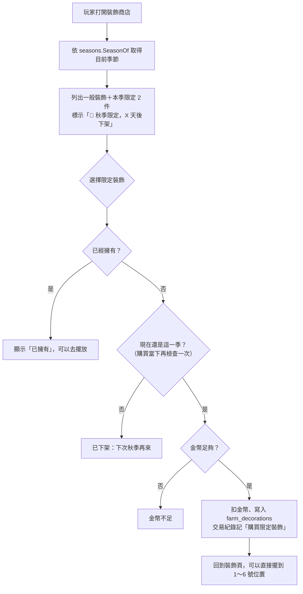
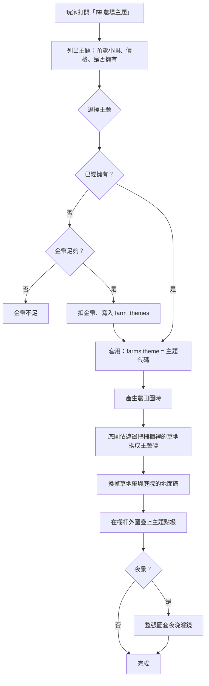
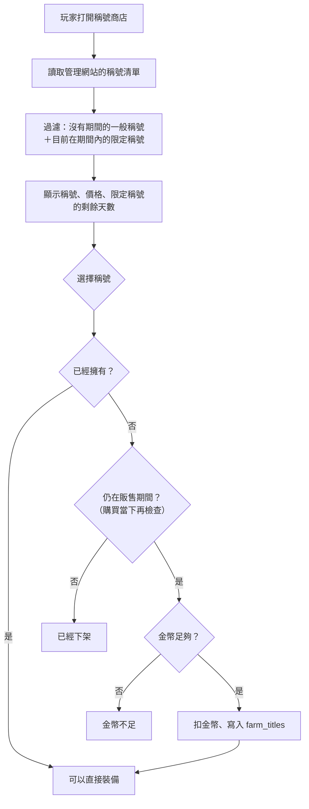
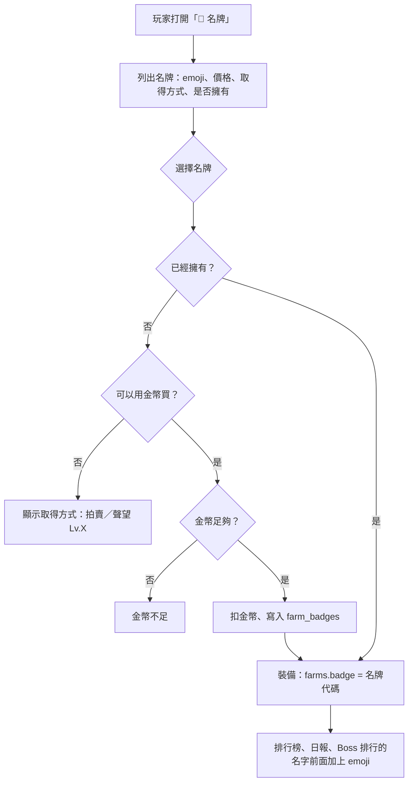
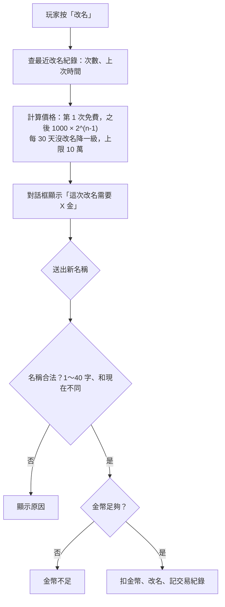
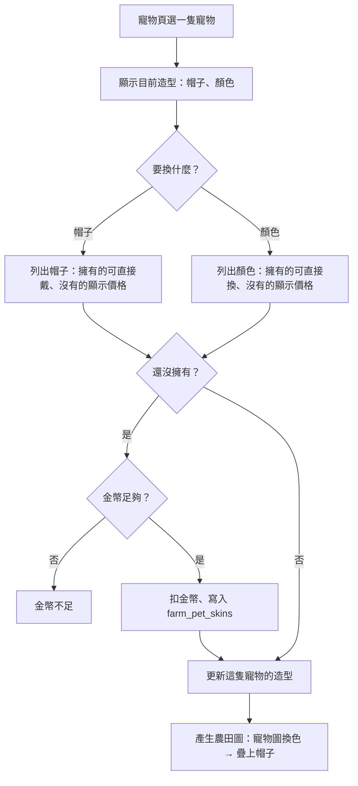
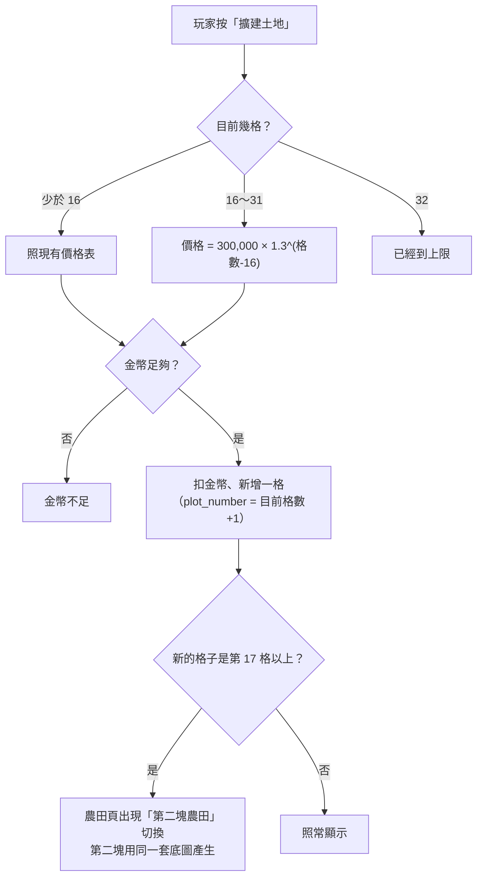
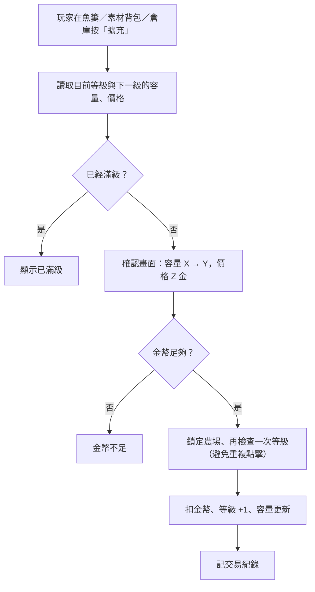
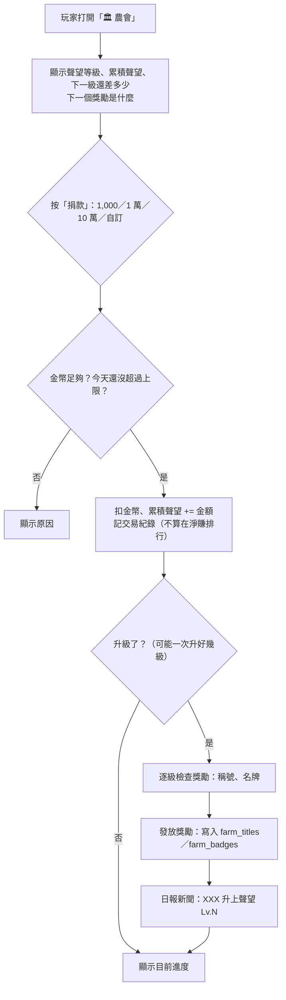
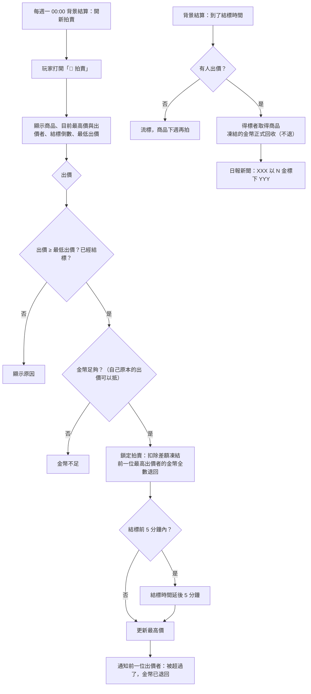

# 金幣回收第二波：外觀、擴充、聲望與拍賣（設計與流程圖，2026-11-19 草案，尚未實作）

目的：給有錢的玩家更多「花得下去」的地方，金幣直接回收、不流回其他玩家，並且不加重新手負擔。
這些都是**選用**的消費，不碰種子、餵食、前 16 格土地這些必要的支出。

## 總覽

| # | 項目 | 類型 | 需要 Migration | 需要美術 | 現況（2026-11-19 查過程式） |
|---|---|---|---|---|---|
| 1 | 🎨 季節限定裝飾 | 外觀 | 否（沿用 `farm_decorations`） | **是**（8 件） | 裝飾 24 件寫在 `game/decor`，「節慶」只是分級名稱，沒有限定販售 |
| 2 | 🖼️ 農場外觀主題 | 外觀 | 是（`farms.theme`、`farm_themes`） | **是**（3 套） | 農田底圖 `field/base_04～16.png`，沒有主題的概念 |
| 3 | 🏷️ 稱號商店擴充（含每月限定） | 外觀 | 否（稱號商店本來就能在管理網站調整） | 否 | 已有 4 個稱號（10 萬～100 萬），每個只能買一次 |
| 4 | 📛 名牌（排行榜、日報的特殊標記） | 外觀 | 是（`farms.badge`、`farm_badges`） | 否（用 emoji） | 排行榜顯示 `名稱〔稱號〕`，日報**沒有**顯示稱號 |
| 5 | ✏️ 改名費 | 調整 | 否 | 否 | **已經有了**：改名固定 300 金 → 改成逐次加價 |
| 6 | 🐾 寵物造型（帽子＋換色） | 外觀 | 是（`farm_pet_skins`） | **是**（6 頂帽子） | 5 隻寵物，沒有造型的概念 |
| 7 | 🌱 土地第 17 格以上 | 永久升級 | 否 | 否（沿用現有底圖） | 上限 16 是程式寫死的，資料庫**沒有**上限；農田圖超過 16 格會被截掉 |
| 8 | 🧺 魚簍、素材背包、倉庫後段擴充 | 永久升級 | 素材背包要（`farms.material_bag_level`） | 否 | 魚簍 Lv.4（100 格），資料庫允許到 Lv.10；素材背包固定 1000 格；倉庫最多 300 格 |
| 9 | 🏛️ 農場聲望（捐給農會） | 金幣黑洞 | 是（`farm_reputation`） | 否 | 沒有聲望或農會相關的程式 |
| 10 | 🔨 每週系統拍賣 | 金幣黑洞 | 是（`auctions`、`auction_bids`） | **是**（拍賣限定裝飾 4 件） | 沒有拍賣相關的程式 |

Migration 由 Python 專案的 Alembic 管理，目前到 0045；下面需要 Migration 的項目可以合併成 0046 一次做。

---

## 1. 🎨 季節限定裝飾

規則：
- 季節沿用現有的輪替（`game/seasons`：每 14 天換一季，春 → 夏 → 秋 → 冬），每一季在裝飾商店多賣 2 件限定裝飾。
- 只有在那一季才買得到，換季就下架；已經買的永久保留，可以照常擺放、收起。
- 價格放在 Fine 和 Rare 之間（建議 50,000），跟現有的「節慶」分級一樣。
- 不需要新的資料表：限定裝飾就是在 `decor.Items` 多一個「販售季節」欄位，購買時檢查目前的季節。



畫面調整：
- 裝飾商店最上面加「本季限定」區塊，顯示下架倒數。
- 圖鑑或背包的裝飾列表標示「已絕版」（不在本季販售的限定款），讓擁有者有收藏感。

---

## 2. 🖼️ 農場外觀主題

規則：
- 主題：❄️ 雪地、🌸 櫻花、🌙 夜景（之後可以再加）。每個主題買一次永久擁有，可以隨時切換，也可以換回預設。
- 建議價格 80,000～150,000。
- 不重畫農田底圖（13 張底圖 × 每個主題太多），改用遮罩換地面：
  - 上方寵物草地、左右庭院的地面磚換成主題的磚（雪地、櫻花落葉、夜晚草地）。
  - 柵欄裡的草地（外圈、鎖住的格子、第二塊農田之間）也換成同一種磚（2026-11-19 新增，見下方「農田底圖換地面」）。
  - 欄杆外圍固定位置疊上主題點綴（雪堆、櫻花瓣、螢火蟲燈）。
  - 夜景另外對整張圖套一層偏藍、變暗的濾鏡。
- 柵欄、泥土格、障礙物、作物不變，作物狀態一樣看得清楚。

### 農田底圖換地面

每張底圖 `field/base_NN.png` 配一張遮罩 `field/masks/base_NN.png`（灰階，同樣 512×502；白色 = 換成主題地面，黑色 = 保留原圖，灰色 = 半透明混合）。

1. **產生遮罩**（只有底圖改變時才要重做）：
   ```powershell
   cd internalotarmimage
   $env:FARMGM_FIELD_MASK_GEN = "1"; go test -run TestGenerateFieldMasks -count=1 .
   ```
   依顏色找出黃綠色、大片相連的草地；被草地包圍的小白花、小石子一起換；格子中央的小區塊不換（避免有青苔的石頭被吃掉）。
2. **看預覽**：
   ```powershell
   $env:FARMGM_STYLE_PREVIEW = "輸出資料夾"; go test -run "TestThemedField|TestStyledPreview" -count=1 .
   ```
   每個主題輸出 4、6、9、12、16、32 格的圖。
3. **手動修圖**（自動結果不滿意時）：用小畫家或 Aseprite 打開遮罩，白色塗掉漏換的草、黑色塗回被誤換的障礙物，存成灰階 PNG。**修過之後不要再跑步驟 1**，會被覆蓋。
4. 執行 `go test ./internal/bot/farmimage/`：每張底圖都要有遮罩、大小要一樣，每個主題都要能畫。

有主題時不使用預先產生的農田圖（presets 的底是綠草），每次在換好地面的底圖上畫作物（換好的底圖有快取）。

**新增主題**只要加地面磚與 2 個點綴（見下方圖 B 的提示詞），加到 `game/cosmetics` 的 `Themes`；遮罩所有主題共用，不必重做。



快取：農田圖的快取 key 要加上主題代碼，否則換主題後會顯示舊圖。

---

## 3. 🏷️ 稱號商店擴充（含每月限定）

規則：
- 一般稱號：再加幾個更高價的稱號（例如 200 萬、500 萬），直接在管理網站「特殊商店」新增即可，不用改程式。
- 每月限定稱號：每個稱號多兩個欄位「開始販售」「結束販售」（存在管理網站設定裡，不需要 Migration），只在期間內出現在商店。
- 限定稱號建議用月份命名（例如「2026 冬至農夫」），買過的人永久保留，之後不再販售。



管理網站：稱號設定表加上「開始／結束日期」兩欄，留空表示一般稱號。

---

## 4. 📛 名牌（排行榜、日報的特殊標記）

Discord 的排行榜和日報都是文字，沒辦法畫框，所以「名牌」做成**名字前面的 emoji 標記**，不需要美術。

規則：
- 名牌例如 👑、💎、🔥、🌟、🍀、🐉，每個買一次永久擁有，同時只能裝備一個。
- 建議價格 30,000～300,000，稀有的名牌可以只從拍賣（第 10 項）或聲望（第 9 項）取得。
- 顯示位置：
  - 排行榜：`👑 名稱〔稱號〕`（`pages_social.go` 的排行榜輸出）。
  - 日報：`👑 **名稱**`（`news.go` 的 `who()`）。日報目前不顯示稱號，這次只加名牌，避免日報太長。
  - 世界 Boss 排行。



注意：日報有快取時，要確認換名牌後的顯示是當天重新產生的。

---

## 5. ✏️ 改名費（改成逐次加價）

**改名費已經有了**（`balance.RenameFarmCost = 300`，每次都是 300 金），所以這一項改成「逐次加價」才有回收效果：

- 第 1 次免費（給剛建立農場、取錯名字的新手）。
- 之後每次 ×2：1,000 → 2,000 → 4,000 …，上限 100,000。
- 每 30 天沒有改名，價格降一級，避免老玩家永遠卡在最高價。
- 次數從交易紀錄（`EvRenameFarm`）計算，不需要 Migration。



---

## 6. 🐾 寵物造型（帽子＋換色）

規則：
- 不影響數值，純外觀。
- **帽子**：6 頂（草帽、聖誕帽、皇冠、蝴蝶結、花圈、巫師帽），每頂買一次，所有寵物都能戴。
- **換色**：程式直接調整寵物圖的色相（例如粉紅、藍、金），不需要另外畫圖。
- 每隻寵物各自設定戴哪頂帽子、用哪個顏色。
- 建議價格：帽子 20,000～80,000，換色每種 30,000。
- 美術只需要帽子圖；帽子在每隻寵物頭上的位置寫在 `manifest.json`（每隻寵物一個座標）。



快取：寵物圖的快取 key（`presetWithPetsPNG`）要加上造型。

---

## 7. 🌱 土地第 17 格以上

**資料庫沒有上限**（只有 `plot_number` 為正數、同一座農場不重複），16 格的上限是程式寫死的（`balance.MaxPlots`），所以**不需要 Migration**。

但農田圖只做到 16 格，超過的會被截掉。建議做法：

- 第 17～32 格是「第二塊農田」，用同一套底圖（17 格 = 第二塊 1 格）另外產生一張圖，不需要新美術。
- 農田頁加「第一塊／第二塊」切換；一鍵澆水、收成等操作不受影響。
- 價格指數成長：第 17 格 300,000，之後每格 ×1.3（第 32 格約 1,550 萬）。上限先定 32 格，之後要加再說。
- 要一起檢查：自動種植、自動澆水、偷菜、每日上限等邏輯有沒有假設最多 16 格（例如迴圈上限、選單 25 個選項的限制）。



---

## 8. 🧺 魚簍、素材背包、倉庫後段擴充

| 項目 | 現況 | 新增的後段 | 需要 Migration |
|---|---|---|---|
| 魚簍 | Lv.4 = 100 格，價格 30k／50k／100k／200k | Lv.5～10：每級 +20 格，價格 400k → 800k → … ×2 | 否（資料庫本來就允許到 Lv.10） |
| 素材背包 | 固定 1000 格，不能擴充 | Lv.1～10：每級 +200 格，價格 50k 起每級 ×1.8 | 是（`farms.material_bag_level`） |
| 倉庫 | 最多 300 格（5 次擴充，到 200k） | 第 6 次以後每次 +50 格，價格 400k 起每次 ×1.6，上限先定 600 格 | 要先確認 `warehouse_capacity` 有沒有 CHECK 上限 |



價格表都放在管理網站，方便之後調整。

---

## 9. 🏛️ 農場聲望（捐給農會）

最單純的金幣黑洞：捐出去的金幣完全消失，換到的只有聲望等級和外觀獎勵。

規則：
- 在「🏛️ 農會」捐金幣，1 金 = 1 聲望點。一次最少 1,000 金。
- 等級沒有上限，需要的累積聲望：`10,000 × 等級^1.5`（Lv.1 = 1 萬、Lv.10 約 31.6 萬、Lv.50 約 354 萬）。
- 每 5 級給獎勵，只給外觀，不給數值：
  - Lv.5、15、30、50…：專屬稱號（「農會會員」「農會理事」「農會長老」…）。
  - Lv.10、25、40…：專屬名牌（第 4 項）。
- 排行榜加「🏛️ 聲望」分頁；日報出現「XXX 升上聲望 Lv.20」。
- 每天捐款上限（例如 100 萬），避免一次捐光後失去目標；要不要設上限可以再討論。



---

## 10. 🔨 每週系統拍賣

規則：
- 每週一 00:00（台灣時間）開一場，週日 21:00 結標，拍 1 件限定商品（拍賣限定裝飾、稀有名牌、限定稱號輪流）。
- 起標價和最低加價由管理網站設定（例如起標 50,000、每次至少加 5%）。
- **出價時先凍結金幣**：從玩家金幣扣下來放到拍賣；被別人超過時立刻退回。這樣得標者一定付得出錢，不會有得標後付不出來的問題。
- 防止最後一秒搶標：結標前 5 分鐘內有人出價，結標時間延後 5 分鐘。
- 結標：最高出價者得到商品，**得標金額全數回收**（不給任何玩家）；沒人出價就流標，商品下週再拍或換一件。
- 結算用 advisory lock 和唯一限制，跟現有的排名、Boss 結算一樣，避免重複發獎。



---

## 美術素材需求（一次生成，合成一張圖）

只有第 1、2、6、10 項需要圖。風格比照現有素材：像素風、深色描邊、左上打光、透明背景。
每張圖排成格子、格子之間留透明空隙，生成後交給我切圖、縮放（最鄰近縮放，像素不會糊）。

### 圖 A：季節限定裝飾＋拍賣限定裝飾（4 欄 × 3 列，共 12 件，縮成 64×64）

```
A single sprite sheet of 12 pixel art yard decoration objects for a cute cozy farm game, arranged in a strict
grid of 4 columns and 3 rows, each object centered in its own square cell, generous empty transparent gap
between cells, no overlapping, no grid lines, no borders, no labels, no text, fully transparent background
(not white).

Consistent style for every object: pixel art, bold dark brown outline, soft top-left lighting with a small
white highlight, limited warm palette, crisp hard pixels, no anti-aliasing, no blur, front view slightly from
above, standing on the ground with its base at the bottom of the cell, no ground shadow, each object fills
about 80% of its cell.

Row 1 (spring and summer limited):
1. sakura arch: small wooden garden arch covered with pink cherry blossoms
2. tulip cart: little wooden hand cart full of red, yellow and pink tulips
3. watermelon stand: tiny wooden fruit stall with a striped awning and sliced watermelons
4. beach umbrella: red and white striped beach umbrella with a small wooden deck chair

Row 2 (autumn and winter limited):
5. maple tree: small round tree with bright red and orange maple leaves, a few leaves falling
6. harvest cart: wooden cart loaded with pumpkins, corn and wheat bundles
7. ice sculpture: sparkling light blue ice sculpture of a swan on a small snowy base
8. snow lantern: stone garden lantern topped with snow, warm yellow light glowing inside

Row 3 (auction exclusive, more luxurious with gold accents):
9. golden windmill: small windmill with golden blades and white walls, gold trim
10. crystal fountain: round fountain made of glowing light blue crystal, sparkling water
11. rainbow arch: small arch shaped like a rainbow with fluffy clouds at both ends
12. dragon statue: friendly jade green dragon statue coiled on a stone pedestal
```

| | 第 1 欄 | 第 2 欄 | 第 3 欄 | 第 4 欄 |
|---|---|---|---|---|
| 第 1 列 | 櫻花拱門 `sakura_arch` | 鬱金香推車 `tulip_cart` | 西瓜攤 `watermelon_stand` | 海灘傘 `beach_umbrella` |
| 第 2 列 | 楓樹 `maple_tree` | 豐收推車 `harvest_cart` | 冰雕天鵝 `ice_sculpture` | 雪燈籠 `snow_lantern` |
| 第 3 列 | 黃金風車 `golden_windmill` | 水晶噴泉 `crystal_fountain` | 彩虹拱門 `rainbow_arch` | 玉龍雕像 `dragon_statue` |

### 圖 B：農場外觀主題（3 欄 × 3 列，共 9 張，縮成 64×64）

每一列是一個主題：第 1 格是地面磚（要能上下左右無縫拼接），第 2、3 格是放在欄杆外圍的點綴。

```
A single sprite sheet of 9 pixel art tiles and props for a cute cozy farm game, arranged in a strict grid of
3 columns and 3 rows, each item in its own square cell, generous empty gap between cells, no grid lines,
no borders, no labels, no text.

Consistent style: pixel art, top-down view slightly from above, bold dark brown outline on props (not on
ground tiles), soft top-left lighting, limited palette, crisp hard pixels, no anti-aliasing, no blur.
Column 1 of every row is a SEAMLESS square ground texture that fills its whole cell edge to edge and tiles
perfectly in all four directions, no outline, no border. Columns 2 and 3 are props on a fully transparent
background (not white), no ground shadow.

Row 1 (snow theme):
1. seamless snowy ground texture, white snow with light blue shading and tiny sparkles
2. small snow pile with a carrot-nosed tiny snowman head peeking out
3. snow-covered pine bush with icicles

Row 2 (cherry blossom theme):
4. seamless green grass texture scattered with fallen pink cherry blossom petals
5. small pink cherry blossom shrub in full bloom
6. little pile of pink petals with a small stone

Row 3 (night theme):
7. seamless dark blue-green night grass texture with a few tiny glowing dots
8. small wooden post with a glowing paper lantern, warm light
9. cluster of three glowing yellow fireflies above a small grass tuft
```

| | 地面磚（無縫） | 點綴 1 | 點綴 2 |
|---|---|---|---|
| ❄️ 雪地 `snow` | `theme_snow_tile` | `theme_snow_pile` | `theme_snow_bush` |
| 🌸 櫻花 `sakura` | `theme_sakura_tile` | `theme_sakura_shrub` | `theme_sakura_petals` |
| 🌙 夜景 `night` | `theme_night_tile` | `theme_night_lantern` | `theme_night_fireflies` |

### 圖 D：農田主題細節（4 欄 × 3 列，共 12 件；配合「農田底圖換地面」）

每一列是一個主題（雪地、櫻花、夜景）。背景用純洋紅色 #FF00FF，切圖時去背（AI 產生的「透明背景」常常是假的格紋）。

| 欄 | 用途 | 縮成 | 放在哪裡 |
|---|---|---|---|
| 1 | 泥土格邊框疊圖：只有邊緣有東西，中間鏤空 | 96×90（畫的時候再縮成格子大小＋6） | 每塊土地上，濕土之上、作物之下 |
| 2 | 柵欄樁頂 | 24×14 | 每根柵欄樁的頂端 |
| 3 | 橫向柵欄疊圖 | 96×14（畫的時候拉成兩根樁之間的寬度） | 上下兩排柵欄橫木上 |
| 4 | 地面小點綴 | 24×24 | 隨機撒在柵欄裡換過的地面上，打散地磚的重複感 |

```
A single sprite sheet of 12 pixel art overlay pieces for a cute cozy top-down farm game, arranged in a
strict grid of 4 columns and 3 rows, each piece centered in its own square cell, generous empty gap between
cells, no grid lines, no borders, no labels, no text.

Background: the ENTIRE background, including all gaps and the inside of hollow frames, is one flat solid
pure magenta color #FF00FF. No gradient, no shadow on the background, no checkerboard. Never use magenta or
pink-purple close to #FF00FF inside the pieces.

Consistent style: pixel art, top-down view slightly from above, soft top-left lighting, limited palette,
crisp hard pixels, no anti-aliasing, no blur, thin dark outline only where needed, matching a farm with
brown wooden fence posts and rich brown tilled soil plots.

Columns (same for every row):
1. HOLLOW rounded-square frame overlay for a soil plot, wider than tall (ratio about 92:86): decoration only
   along the outer edge, about 10% of the width thick, the whole center is empty magenta background.
2. small cap that sits on top of a round wooden fence post, wider than tall (ratio about 24:14), only the cap,
   no post.
3. horizontal strip that sits on top of a wooden fence rail, very wide and thin (ratio about 64:12), left and
   right ends must connect seamlessly when repeated, only the overlay, no wood.
4. tiny ground detail, about one quarter of the cell, very low contrast so it does not distract.

Row 1 (snow theme):
1. soft white snow piled along the edges of the plot frame with light blue shading
2. rounded white snow cap with a tiny light blue shadow
3. thin layer of white snow lying on a rail with a few short icicles hanging below
4. small cluster of tiny ice crystals and snow sparkles

Row 2 (cherry blossom theme):
1. scattered pink cherry blossom petals and a few small blossoms along the edges of the plot frame
2. small sprig of pink cherry blossoms with two green leaves
3. a string of pink petals and tiny blossoms resting along a rail
4. three fallen pink petals

Row 3 (night theme):
1. tiny glowing dew drops and faint blue sparkles along the edges of the plot frame
2. tiny glowing firefly resting on top, warm yellow glow
3. thin line of soft moonlight highlight with a few dew drops
4. two tiny glowing yellow fireflies
```

| | 泥土格邊框 | 柵欄樁頂 | 柵欄橫木 | 地面小點綴 |
|---|---|---|---|---|
| ❄️ 雪地 `snow` | `theme_snow_plot` | `theme_snow_cap` | `theme_snow_rail` | `theme_snow_dot` |
| 🌸 櫻花 `sakura` | `theme_sakura_plot` | `theme_sakura_cap` | `theme_sakura_rail` | `theme_sakura_dot` |
| 🌙 夜景 `night` | `theme_night_plot` | `theme_night_cap` | `theme_night_rail` | `theme_night_dot` |

**2026-11-19 改版**：改用專案根目錄的 `5p.png`（5 個主題：雪地、櫻花、夜景、海灘、城堡，下方是素材）。之後刪掉櫻花主題，目前是雪地、夜景、海灘、城堡 4 個；已經套用櫻花的農場顯示預設外觀。
- 地面磚不從圖裡切，改成程式產生的低對比紋理（128×128；雪地、夜景、沙灘是三色雜訊，城堡是石板；櫻花沿用原本的草地），避免太花。
- 柵欄圖兩端帶樁，蓋住上下兩排柵欄；左右兩排只疊樁頂。
- 鎖住的格子保留原本的草地，只換柵欄裡的外圈。
- 每個主題的素材：`plot`（九宮格縮放成 96×90）、`cap`、`dot`、`dot2`、`rail`、`bush`、`prop`。

舊版：原圖是專案根目錄的 `p.png`（不打包進程式）。切圖方式：去掉洋紅背景（`min(R,B) − G > 90` 視為背景）→ 依每格的範圍裁切 → 縮成上表大小（點綴保持比例放進 24×24）→ 半透明的像素二值化。
畫法見 `internal/bot/farmimage/field_theme.go`；某個主題缺少其中幾張圖時，就不畫那幾樣。

### 圖 C：寵物帽子（3 欄 × 2 列，共 6 頂，縮成 32×32）

```
A single sprite sheet of 6 pixel art hats for small cute pets in a cozy farm game, arranged in a strict grid of
3 columns and 2 rows, each hat centered in its own square cell, generous empty transparent gap between cells,
no overlapping, no grid lines, no borders, no labels, no text, fully transparent background (not white).

Consistent style: pixel art, front view, bold dark brown outline, soft top-left lighting with a small white
highlight, limited warm palette, crisp hard pixels, no anti-aliasing, no blur, no shadow, hat only with no head
or character, each hat fills about 80% of its cell, simple shapes that still read clearly at 32x32 pixels.

Row 1:
1. straw hat: small woven straw sun hat with a red ribbon
2. santa hat: red santa hat with white fur trim and a white pompom, tip flopping to the side
3. crown: small golden crown with three points and red and blue gems

Row 2:
4. bow: big pink ribbon bow
5. flower crown: ring of small white, pink and yellow flowers with green leaves
6. wizard hat: tall purple pointed wizard hat with yellow stars
```

| | 第 1 欄 | 第 2 欄 | 第 3 欄 |
|---|---|---|---|
| 第 1 列 | 草帽 `straw_hat` | 聖誕帽 `santa_hat` | 皇冠 `crown` |
| 第 2 列 | 蝴蝶結 `bow` | 花圈 `flower_crown` | 巫師帽 `wizard_hat` |

不需要美術的項目：稱號（文字）、名牌（emoji）、改名費、土地第 17 格以上（沿用現有底圖）、各種擴充、聲望、拍賣的介面（文字）。

---

## 待決定

1. 各項價格（上面都是建議值，實作時放在管理網站，可以隨時調整）。
2. 聲望要不要每日捐款上限。
3. 拍賣的商品輪替順序，以及流標時要不要降低起標價。
4. 倉庫的 `warehouse_capacity` 有沒有資料庫 CHECK 上限，實作前要先查。
5. 實作順序建議：改名加價、稱號限定（不用 Migration）→ 魚簍後段、土地 17 格以上 → 聲望、名牌 → 限定裝飾、主題、寵物造型（等美術）→ 拍賣（最複雜）。
