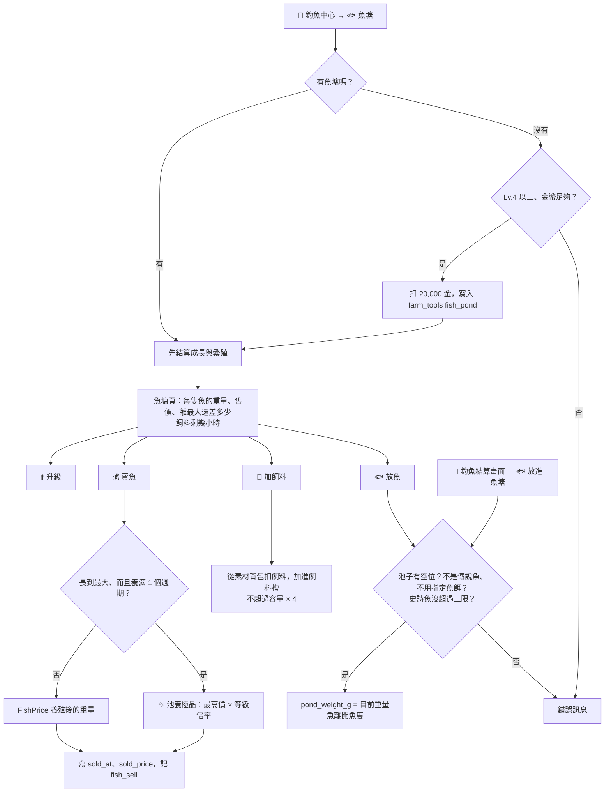
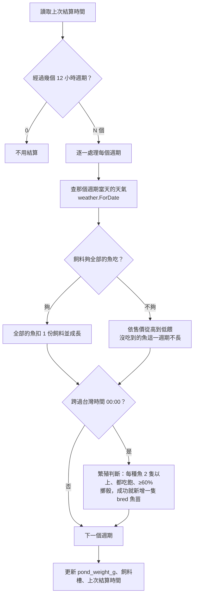

# 🐟 魚塘：設計與流程圖（v5，2026-11-24 已實作；原名「養魚塘」）

> ✅ **2026-11-24 已實作**（使用者要求：和「消耗品當天逐次加價」一起做，名稱改成「魚塘」）。程式：`game/pond`（規則）、
> `services/pond.go`（服務）、`bot/pages_pond.go`（面板），Migration `migrations/versions/0049_fish_pond.py`。
> 和下面設計不同、或還沒做的地方：
> - **魚飼料的價格**在管理網站「設施與道具價格」調整（和其他道具一樣），不在「魚塘」設定裡。
> - **磨坊做魚飼料（小麥 → 魚飼料 ×5）還沒做**，目前只能在道具商店買，或按魚塘頁的「補滿飼料」直接買。
> - **補滿飼料**：先用素材背包裡的魚飼料，不夠的部分自動用目前的價格買（金幣不夠時買得起多少就補多少）。
> - **長滿的魚也要吃飼料**（不會再長，但要吃到才算「吃飽」，才能繁殖）。
> - **魚塘不能拆除**（不佔農田，不需要拆）。
> - 介紹網站的魚塘說明 2026-11-25 已補（手冊「🐟 魚塘」、首頁卡片）；同一天自動販售機也可以依稀有度保留自動釣魚機的魚，方便放進魚塘。
> - 入口：釣魚中心、魚簍頁的「🐟 魚塘」，釣魚結算畫面的「🐟 放進魚塘」（傳說魚不顯示）；總覽待辦區會提示池養極品與飼料不足。
> - 本機沒有測試資料庫，需要資料庫的測試（`services/pond_test.go`）還沒有實際跑過；規則的單元測試（`game/pond`）已通過。

把釣到的魚放進池子養大再賣，同種的魚還有機率繁殖。目標是**讓釣魚多一段後續玩法**：現在魚一釣到就只能賣掉或捐給 Boss，有了魚塘以後，輕的魚也有價值。

> **版本紀錄**
> - v1：初稿，金額用假設的魚價。
> - v2：對照 `fishing.InitialFish` 的實際魚價重算（實際魚價比假設的低很多）。
> - v3：建造費、收益調高，加上史詩魚上限，收益改用模擬程式計算。
> - v4：魚塘放在釣魚介面，不佔農田；建造費與收益再提高（總建造費 **770,000**，Lv.5 每天約 2,050 金）。
> - **v5（使用者要求：建造費維持，Lv.5 每天收入 10,000 金左右）**：容量 8～20 → **10～30** 隻、每週期成長 20% → **30%**、池養極品倍率改成**隨等級提高**（×1.7～×3.0）。Lv.5 每天約 **8,500～11,400 金**，累計回本 **68～91 天**。

## 一眼看懂

| 項目 | 內容 |
|---|---|
| 開放 | 農場 **Lv.4** |
| 位置 | **🎣 釣魚中心**裡的「🐟 魚塘」，**不佔農田、不畫在農田圖上** |
| 能放的魚 | 魚簍裡的**普通、稀有、史詩**魚，**不含要用指定魚餌的魚**；史詩魚最多佔容量的 1/4 |
| 成長 | 有飼料時，每 12 小時變重一次，最多長到這種魚的最大重量 |
| 池養極品 | 長到最大重量時，售價 = **最高價 × 等級倍率**（Lv.1 ×1.7 → Lv.5 ×3.0） |
| 繁殖 | 同種魚 2 隻以上、都吃飽、夠大 → 每天有機率生 1 隻魚苗 |
| 賣出 | **只能從魚塘直接賣**，不能放回魚簍 |
| 收益 | Lv.1 每天約 **700～900 金**，Lv.5 每天約 **8,500～11,400 金** |
| 金幣回收 | 建造與升級總共 **770,000 金**，加上飼料 |
| Migration | 需要 **0049**（`farm_fish` 多 2 個欄位，見下方） |
| 美術 | 魚塘頁的橫幅圖 3 張（選用），其他用 emoji |

## 設計時參考的現況（看過程式）

- 每隻魚是 `farm_fish` 的一列，**售價由重量決定**：`fishing.FishPrice` 依重量在魚種的最低價～最高價之間換算，超過最大重量也不會更貴。
- 釣到的重量**偏輕**（`RollWeight` 用 `rng^1.6`），平均落在重量區間的 **38.5%**，所以大部分的魚都還有成長空間。
- `farm_fish.weight_g`、`price` 是**捕獲當下的紀錄**（模型註解寫明「之後不變」），排行榜、最大魚紀錄、圖鑑都讀這兩個欄位。**魚塘不能改這兩個欄位**，否則排行榜會被養殖魚洗掉。
- 「魚在不在魚簍」統一由 `fishrepo.InBasket()` 判斷（`sold_at IS NULL AND donated_at IS NULL`），所以只要在這個函式加一個條件，魚簍、販售、Boss 捐魚就會自動排除池子裡的魚。
- 魚塘的設定（等級、飼料、上次結算時間）存在 `farm_tools`（`tool_code = fish_pond`）的 `settings` JSON，和蜂箱、菇房的做法相同。
- 賣魚沿用既有的交易類型 `fish_sell`；建造、升級、買飼料沿用 `buy_item`，**不需要新的交易類型**。

### 拿來比較的現有收入（預設值）

| 來源 | 每天大約 | 成本 |
|---|---|---|
| 🍯 蜂箱（佔 1 格農田） | 1,200 金 | 放置 8,000 金，升到 Lv.5 共 378,000 金 |
| 🌱 1 格種作物（勤勞地重種） | 250～350 金 | 種子錢 |
| 🎣 自動釣魚機 | 每 5 分鐘 1 條魚，一天 288 條（多半是普通魚） | 100,000 金 |
| 🧺 魚簍 | 容量 40～220 隻 | 擴充 30,000 金起 |

魚塘 Lv.5 每天約 10,000 金，**大約是 8 個蜂箱**，是全遊戲最賺的設施（使用者決定）。代價是累計 770,000 金的建造費，而且要自己釣稀有魚、史詩魚來放、要加飼料。**通膨風險見「收益估算」最後一段。**

---

## 規則

### 1. 建造與升級

| 等級 | 費用 | 容量（隻） | 其中史詩魚最多 | 成長速度加成 | 每週期成長（佔重量區間） | 池養極品倍率 |
|---|---|---|---|---|---|---|
| Lv.1 | 20,000 | 10 | 2 | +0% | 30% | ×1.7 |
| Lv.2 | 50,000 | 14 | 3 | +20% | 36% | ×1.9 |
| Lv.3 | 100,000 | 18 | 4 | +40% | 42% | ×2.2 |
| Lv.4 | 200,000 | 24 | 6 | +60% | 48% | ×2.6 |
| Lv.5 | 400,000 | 30 | 7 | +80% | 54% | ×3.0 |
| **合計** | **770,000** | | | | | |

- 池養極品倍率**以賣出當下的魚塘等級**計算，所以升級後，池子裡已經長滿的魚也會跟著變值錢。

- 入口在「🎣 釣魚中心」的「🐟 魚塘」按鈕；還沒蓋的時候，按下去是建造說明頁。
- 每座農場 1 個魚塘，不能拆除（不佔農田，不需要拆）。

### 2. 放魚

- 兩個放魚的地方：
  - **魚塘頁**的「🐟 放魚」：從魚簍複選要放的魚，一次最多放到池子滿。
  - **釣魚結算畫面**多一個「🐟 放進魚塘」按鈕：剛釣到的魚可以直接放進去（池子滿了或這條魚不能放時，按鈕不出現）。
- **不能放的魚**：
  - **傳說魚**：本來就稀有又值錢，再養大會太強。
  - **要用指定魚餌才釣得到的魚**（`fish_types.required_baits` 有值，例如黃鰭鮪、旗魚）：這些深海魚的價格區間很大，養到 Lv.5 極品，一隻旗魚可以多賺 1,000 金以上。畫面上說明「🌊 深海魚沒辦法養在池塘裡」。
- **史詩魚最多佔容量的 1/4**（無條件捨去：Lv.1 2 隻、Lv.2 3 隻、Lv.3 4 隻、Lv.4 6 隻、Lv.5 7 隻）。畫面上說明「🐡 史詩魚太大了，這個池子最多養 N 隻」，升級後可以多放。
- 已經是最大重量的魚也可以放，但要**養滿 1 個週期**（12 小時）才算「池養極品」，避免玩家放進去馬上拿出來賣，白賺 70%～200%。
- 放進去之後，**魚簍會多出空位**。

> ⚠️ **注意：魚塘會和「魚簍擴充」搶生意。** 魚塘等於多了一個存魚的地方，可能讓玩家不買魚簍擴充。所以設計成：**容量比魚簍小（最多 30 隻，魚簍是 40～220 隻）、魚放進去就回不了魚簍、只能從池子賣**。

### 3. 飼料

- 新物品 **🌾 魚飼料**（`fish_feed`），放在素材背包。取得方式：
  - **釣具商店**買，**3 金／個**（和魚餌放在一起）。
  - 磨坊加工：**小麥 ×1 → 魚飼料 ×5**（小麥售價 11 金，等於每個飼料約 2.2 金，比買的便宜）。
- 飼料放進池子的**飼料槽**，最多存「容量 × 4」份，池子滿的時候大約可以吃 2 天。
- 每隻魚每 12 小時吃 1 份。飼料不夠時，**先餵售價高的魚**，沒吃到的魚這一週期不長。
- **沒飼料的魚只會停止成長，不會死掉**。
- 飼料成本大約是收入的 **2～3%**（Lv.5 滿池一天吃 60 份，買的要 180 金，自己做約 132 金），幾乎可以忽略，主要是讓玩家記得每天回來加。

### 4. 成長

每經過一個 12 小時週期，有吃到飼料的魚：

```
增加的重量 = (最大重量 − 最小重量) × 30% × (1 + 等級加成) × 天氣倍率
新重量 = min(目前重量 + 增加的重量, 最大重量)
```

| 天氣 | 倍率 | 說明 |
|---|---|---|
| ☀️ 晴天 | ×1 | |
| 🌧️ 雨天 | ×1.5 | 池水充足 |
| ⛈️ 暴風 | ×0 | 魚躲起來不長 |
| 乾旱（連續 3 天晴天） | ×0.5 | 沿用 `weather.LuckDrought` 的判斷 |

- 天氣由日期決定（`weather.ForDate`），結算時回推每個週期當天的天氣，**不需要背景排程**。
- 剛釣到的魚平均要多久長到最大（晴天，模擬結果，已考慮週期要整數）：

| 等級 | 平均天數 |
|---|---|
| Lv.1 | 1.3 天 |
| Lv.2 | 1.1 天 |
| Lv.3 | 1.0 天 |
| Lv.4 | 0.9 天 |
| Lv.5 | 0.8 天 |

大約是**每天收一輪**，適合每天上線一次的玩家；一天上線兩次的玩家，Lv.4 以上可以多收一些。

### 5. 繁殖

每天台灣時間 00:00 之後的第一次結算時，對每種魚判斷一次：

- 條件：同一種魚有 **2 隻以上**、昨天**都有吃到飼料**、重量都在區間的 **60% 以上**、池子還有空位。
- 機率：普通 20%、稀有 10%、史詩 4%。
- 每個魚塘**每天最多生 1 隻**。
- 魚苗的重量是這種魚的**最小重量**，從頭養到極品大約要 2 天（Lv.1）～1 天（Lv.5）。
- 魚苗也受史詩魚上限限制：史詩魚的名額滿了，史詩魚就不會繁殖。
- 魚苗會寫成新的一列 `farm_fish`，標記 `bred = true`：
  - 不算進排行榜和最大魚紀錄（和自動釣魚機的魚 `auto` 一樣排除）。
  - 不會新增圖鑑（父母已經登記過了）。
- 繁殖是**額外的小收入**：一對稀有魚平均 10 天多生 1 隻，換算每天約 17 金（Lv.1）～30 金（Lv.5）。重點是讓玩家有「湊一對」的動機，不是主要收入。

### 6. 賣出

- 在魚塘頁選魚賣出：
  - **還沒長滿**：售價 = `FishPrice(魚種價格區間, 養殖後的重量)`，和釣到同樣重量的魚一樣。
  - **長到最大重量（池養極品 ✨）**：售價 = `round(最高價 × 魚塘目前等級的倍率)`。
- 寫入 `farm_fish.sold_at`、`sold_price`（實際售價），**`weight_g`、`price` 保留捕獲時的數值**。
- 交易紀錄沿用 `fish_sell`。
- v1 不能把養殖魚捐給世界 Boss（避免拿養大的魚刷 Boss 貢獻）。

### 7. 收益估算（模擬：`fishing.InitialFish` 裡 32 種可養的魚，各 4 萬次）

**每隻魚養一輪淨賺多少**（已扣飼料，晴天）：

| 稀有度 | 可養的魚 | Lv.1（×1.7） | Lv.5（×3.0） |
|---|---|---|---|
| 普通 | 11 種 | +25 金 | +66 金 |
| 稀有 | 12 種 | +91 金 | +229 金 |
| 史詩 | 9 種 | +228 金 | +562 金 |

**每天的淨收入**（滿池、晴天、扣掉買來的飼料）：

| 等級 | 累計費用 | 只放普通魚 | 只放稀有魚 | 史詩放滿上限＋其餘稀有魚 | 回本（只放稀有魚） | 回本（史詩放滿） |
|---|---|---|---|---|---|---|
| Lv.1 | 20,000 | 194 | 700 | **911** | 29 天 | 22 天 |
| Lv.2 | 70,000 | 411 | 1,431 | **1,885** | 49 天 | 37 天 |
| Lv.3 | 170,000 | 736 | 2,564 | **3,399** | 66 天 | 50 天 |
| Lv.4 | 370,000 | 1,434 | 4,979 | **6,799** | 74 天 | 54 天 |
| Lv.5 | 770,000 | 2,447 | **8,463** | **11,352** | **91 天** | **68 天** |

各版本比較：

| | v3 | v4 | v5 |
|---|---|---|---|
| 建造＋升級總額 | 385,000 | 770,000 | **770,000** |
| Lv.1 每天 | 約 290 金 | 約 560 金 | **約 700～900 金** |
| Lv.5 每天 | 約 930～1,270 金 | 約 1,500～2,050 金 | **約 8,500～11,400 金** |
| Lv.5 回本 | 303 天 | 375 天 | **68～91 天** |

怎麼看這張表：

- **回本天數**：建造費維持 770,000 金、每天約 10,000 金，Lv.5 大約 **68～91 天**回本。如果要壓到 **30 天**，每天要賺約 **25,700 金**（約 21 個蜂箱），所以 v5 沒有做到 30 天。
- **每一級的回本時間都差不多**（每次升級約 40～90 天回本），所以玩家會願意一路升上去，不會卡在某一級。
- **史詩魚上限更重要了**：如果拿掉，Lv.5 放滿 30 隻史詩魚每天會賺約 **20,800 金**。
- **普通魚到 Lv.5 也有每天約 2,400 金**。自動釣魚機一天釣 288 條普通魚，Lv.5 魚塘每天大約能消化 37 條，玩家可以「全自動」賺到這筆錢。如果覺得太多，可以只對稀有以上的魚套用極品倍率。
- 雨天成長 ×1.5，實際收入會比表上再高一點；暴風天和忘記加飼料則會變少。

> ⚠️ **金幣通膨（重要）**：每座 Lv.5 魚塘每天多產生約 8,500～11,400 金，**大約是 8 個蜂箱**。如果 30 座活躍農場都蓋到 Lv.5，全伺服器每天會多出約 **25～34 萬金**。現有的金幣回收（擴充、裝飾、拍賣）可能吸收不了這麼多。建議：
> 1. 上線後在管理網站觀察 2 週的金幣收支。
> 2. 要調的話，先調 **Lv.4、Lv.5 的極品倍率**（例如 ×3.0 → ×2.5，Lv.5 收入大約少 20%），不影響新手。
> 3. 也可以考慮搭配更高價的金幣回收項目，讓有錢玩家有地方花錢。

---

## 流程圖

### 建造、放魚、賣出



### 結算（打開魚塘頁、釣魚中心、總覽時執行）



- 結算要在 `FOR UPDATE` 鎖住魚塘那一列之後進行，避免兩個面板同時結算、重複成長或重複繁殖。
- 最多回推 14 天（28 個週期），超過的部分不算（可在管理網站調整）。

---

## 畫面

- **釣魚中心**：多一個「🐟 魚塘」按鈕；有極品魚時，按鈕上顯示數量（`🐟 魚塘 ✨3`）。
- **釣魚結算畫面**：多一個「🐟 放進魚塘」按鈕（和現有的「🛒 釣具商店」放在一起）。
- **魚塘頁**（`bot/pages_pond.go`，新頁面 `pond`，從釣魚中心進入，「⬅️ 返回」回到釣魚中心）：
  - 每隻魚一行：`🐠 香魚 🔵 260 g / 400 g ▓▓▓▓▓▓░░ 68% · 現在賣 99 金 · 養滿 192 金`；長滿的魚顯示 `✨ 池養極品 192 金`（Lv.1 的價格）。
  - 魚最多 30 隻，Discord 選單一次最多 25 個選項，所以放魚、賣魚的選單要**分頁**（沿用種子庫「丟棄種子」的分頁複選做法），也可以加「依魚種篩選」。
  - **底部（貼近按鈕）**：`🌾 飼料剩 18 小時`、`🐣 今天有機會繁殖：香魚 ×2`。
  - 按鈕：放魚、加飼料、賣魚（複選）、全部賣掉極品魚、升級。
- **總覽待辦區**：飼料不到 6 小時時，顯示「🐟 魚塘飼料快吃完了」；有極品魚時，顯示「✨ 有 N 隻池養極品可以賣」，並附「💰 賣掉極品魚」按鈕。
- **釣具商店**：多賣「🌾 魚飼料」。
- **物品用途查詢**：魚飼料的用途寫「魚塘」。
- **介紹網站**：在釣魚的段落補魚塘說明，數值從 API 讀取（沿用現在的做法）。
- **翻譯**：`zh-TW.json`、`en.json` 都要補（Fish Pond、Fish Feed、Fry、Pond Premium）。

## 管理網站「新功能設定 → 魚塘」

| 設定 | 預設值 |
|---|---|
| 開放等級 | 4 |
| 各級價格 | 20,000／50,000／100,000／200,000／400,000 |
| 各級容量 | 10／14／18／24／30 |
| 史詩魚佔容量的比例上限 | 25% |
| 各級成長加成 | 0／20／40／60／80 % |
| 每週期成長（佔重量區間） | 30% |
| 各級池養極品倍率 | 170／190／220／260／300 %（只能設 100～500%） |
| 天氣倍率 | 晴 100%、雨 150%、暴風 0%、乾旱 50% |
| 飼料商店價格 | 3 |
| 磨坊：1 個小麥做幾個飼料 | 5 |
| 飼料槽倍數 | 容量 × 4 |
| 繁殖條件 | 2 隻以上、重量 60% 以上 |
| 繁殖機率 | 普通 20%、稀有 10%、史詩 4% |
| 每天繁殖上限 | 1 |
| 最多回推天數 | 14 |

設定存在 `feature_settings`，不需要 Migration（和其他「新功能設定」一樣）。

---

## Migration 0049（在 Python 專案）

| 變更 | 內容 |
|---|---|
| `farm_fish.pond_weight_g` | `integer NULL`，有值表示魚在池子裡，數值是養殖後的重量；CHECK `pond_weight_g IS NULL OR pond_weight_g > 0` |
| `farm_fish.bred` | `boolean NOT NULL DEFAULT false`，魚塘生的魚苗 |
| 索引 | `ix_farm_fish_farm_pond`（`farm_id` WHERE `pond_weight_g IS NOT NULL AND sold_at IS NULL`） |
| 降版 | 池子裡的魚改回魚簍（`pond_weight_g` 清空，保留捕獲時的數值），刪除兩個欄位 |

「養滿 1 個週期」的判斷不用新欄位：放魚時把放入時間記在 `farm_tools.settings` 裡（以魚的 id 為 key）。

**Go 端同時要改：**

- `fishrepo.InBasket()` 加上 `AND pond_weight_g IS NULL`，魚簍、販售、Boss 捐魚就會自動排除池子裡的魚。
- 排行榜（`WHERE NOT auto`）改成 `WHERE NOT auto AND NOT bred`。
- `db.AlembicHead` 改為 0049，`dbtest.GameTables` 不用改（沒有新表）。

> ⚠️ **相容性**：Python 版不認得 `pond_weight_g`，會把池子裡的魚當成魚簍裡的魚。所以**有玩家用過魚塘以後，就不能切回 Python 版 Bot**（和新果醬、菇房相同）。`fish_feed` 也是新的物品代碼。

---

## 需要的美術素材（選用）

魚塘不畫在農田圖上，所以**沒有一定要的素材**，畫面可以全部用 emoji。想讓魚塘頁好看一點的話：

| 素材 | 規格 | 說明 |
|---|---|---|
| `fishing/pond_1.png`～`_3.png` | 640×200 橫幅 | 魚塘頁上方的圖：小池塘（Lv.1～2）→ 石砌池（Lv.3～4）→ 有荷葉和小橋的錦鯉池（Lv.5） |

**生圖提示（三張合成一張 640×600，1 欄 × 3 列）**：像素風農場遊戲的魚塘橫幅，斜上方俯視角，色調和現有的釣魚畫面一致；第 1 張是泥土邊的小水塘，有幾條小魚的影子和蘆葦；第 2 張是石頭砌邊的方形池，有睡蓮和小石燈；第 3 張是木框邊的大池子，有荷葉、小木橋和幾條錦鯉；不要文字。

---

## 建議的實作順序

| 步驟 | 內容 | 預計 |
|---|---|---|
| 1 | Python 專案寫 Migration 0049，測試資料庫升級 | 0.5 天 |
| 2 | `game/pond`：成長、極品售價、繁殖、天氣倍率、餵食順序、史詩魚上限的純規則與單元測試 | 1 天 |
| 3 | `services/pond.go`：建造／升級、放魚、加飼料、結算、賣魚；修改 `InBasket` 與排行榜 | 1.5 天 |
| 4 | `bot/pages_pond.go`、釣魚中心與結算畫面的按鈕、釣具商店賣飼料、總覽待辦、翻譯 | 1 天 |
| 5 | 管理網站設定、介紹網站說明 | 0.5 天 |
| 6 | 用**正式環境**的 `fish_types` 重算一次收益表（管理網站可能改過魚價），再到 `farmgm_play` 實機測試 | 0.5 天 |

不畫在農田圖上，所以比 v3 少了改 `farmimage` 的工作。

**測試重點**：池子裡的魚不會出現在魚簍、販售、Boss 捐魚；排行榜不受養殖魚影響；深海魚、傳說魚放不進去；史詩魚上限（放魚、繁殖都要擋）；升級後極品價格跟著變；30 隻魚的選單分頁；剛放進去的滿重魚不能馬上以極品價賣出；同時開兩個面板結算不會重複成長或重複繁殖；飼料不夠時的餵食順序；回推天數上限。

---

## 待決定

1. **要不要讓別人偷魚？** v1 不做。之後可以加「鷺鷥偷魚」隨機事件，用稻草人防守。
2. **傳說魚**：要不要讓它放進池子「展示」（不成長、不繁殖），換一點觀光或聲望加成？可以和之後的「觀光民宿」一起考慮。
3. **NPC 訂單**要不要加「池養極品」的訂單（例如指定 ✨ 香魚 ×2）？
4. **正式環境的魚價**：上面的表是用程式裡的初始值算的，如果管理網站改過魚價，收益會跟著變，實作前要用正式資料重算一次。
